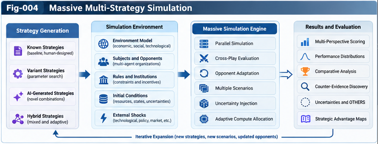
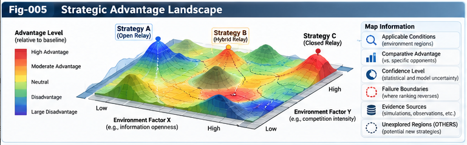
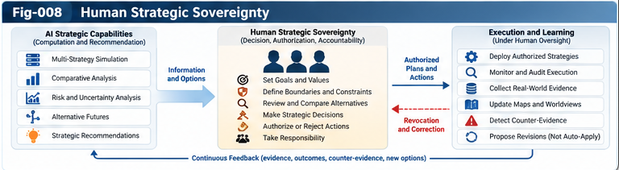

# SSICR — Testable Hypotheses

## Falsifiable Research Program for Strategic Structural Intelligence and Competitive UIRTU-Relay

**Authors:** Sizhe Tan & GPT-Obot  
**Project:** Strategic Structural Intelligence and Competitive UIRTU-Relay (SSICR)  
**Version:** 1.0.0  
**Status:** Proposed hypotheses and preregistration-ready experimental designs; no empirical results claimed  
**Date:** 2026-10-26

---

## Abstract

SSICR proposes that strategically interacting subjects can use structural intelligence, competitive UIRTU-Relay, large-scale multi-strategy simulation, strategic advantage maps, and revisable worldview forests to improve strategic understanding while retaining human decision authority. These propositions must not be mistaken for demonstrated performance. This document turns the program into **twelve falsifiable hypotheses**, specifies estimands, controls, metrics, failure conditions, and a common experimental protocol, and separates computational validity from external strategic validity. It also treats governance as an independently measurable outcome: a system that finds better simulated strategies but silently changes the human principal's objectives has not succeeded. Hypotheses are designed for staged evaluation, beginning with synthetic competitive AI R&D organizations and extending only after replication and independent review.

**Keywords:** structural intelligence; competitive Relay; strategic simulation; cross-play; comparative advantage; strategic advantage map; worldview forest; counter-evidence; Anti-Goodhart; human strategic sovereignty; recursive self-improvement; falsifiability.

---

## 1. Research Position and Evidentiary Status

This is a **prospective research plan**, not a report of experiments already performed. The hypotheses are conditional, the numerical thresholds below are **proposed preregistration criteria**, and any worked examples are illustrative. Simulation can test whether a mechanism works under specified assumptions; it cannot, by itself, establish that a strategy will work in real organizations or societies.

The central question is:

> Can AI-scale strategic exploration yield transferable, contestable strategic knowledge while preserving the authority of human subjects over their objectives, values, and consequential actions?

A positive result requires evidence on **all three axes**: predictive or decision quality, epistemic reliability, and authorized governance. Improvements on one axis cannot compensate for unreported failure on another.

## 2. Formal Experimental Objects

Let a strategic episode be

$$
 e=(s,\pi,\pi_{-s},c,h,p,\omega,a),
$$

where \(s\) is a focal subject; \(\pi\) its strategy; \(\pi_{-s}\) the opponent or partner profile; \(c\) environmental and institutional context; \(h\) decision horizon; \(p\) scoring perspective; \(\omega\) stochastic realization; and \(a\) the principal's authorization envelope.

An outcome \(Y(e)\) is measured separately for each authorized scoring perspective. Comparative advantage is **relative and conditional**:

$$
 \Delta(\pi,\pi_0\mid c,\pi_{-s},h,p)
 =\mathbb E[Y(\pi,\pi_{-s},c,h,p)]
 -\mathbb E[Y(\pi_0,\pi_{-s},c,h,p)].
$$

The baseline \(\pi_0\), perspective \(p\), and context \(c\) must be disclosed. There is no assumption of a universal scalar social welfare function or globally optimal worldview.

A **Strategic Advantage Map (SAM)** estimates regions where \(\Delta\) is positive, uncertain, or negative, and records the corresponding provenance and failure boundaries. A **Strategic Worldview Forest (SWF)** organizes provisional, evidence-linked strategic principles across multiple legitimate perspectives. Neither map nor worldview automatically authorizes action.

## 3. Common Testbed

### 3.1 Initial environment

Start with a configurable, synthetic multi-organization AI R&D environment, consistent with `cases/CASE-001-Competitive-AI-RD-Organizations.md`:

- Subjects: integrated laboratory, open research network, specialist laboratory, and independent evaluation alliance.
- Strategy families: closed integration, open collaboration, selective/hybrid Relay, specialization, evaluation-first, and adaptive switching.
- Resources: compute, personnel, capital, proprietary knowledge, evaluation capacity, and time.
- Institutions: interface standards, licensing constraints, disclosure requirements, coalition rules, and audit mechanisms.
- Dynamics: learning curves, capability complementarities, strategic response, shocks, entry/exit, and policy changes.

All organizations and scores in the initial testbed are fictional. A separate, documented external-validity phase is required before interpreting results as evidence about actual firms.

### 3.2 Experiment splits

Use disjoint sets for **development**, **model selection**, **in-distribution test**, **out-of-distribution test**, and **external validation**. Split not just random seeds but **environment families, opponent policies, institutions, and structural shock types**. Do not let a generated test environment or its answer key leak into prompts, strategy selection, evaluator construction, or map fitting.

### 3.3 Controls

The minimum comparator suite comprises: (B0) fixed expert-designed heuristic; (B1) equal-budget random or evolutionary search; (B2) single-strategy self-play; (B3) multi-strategy search without cross-play; (B4) cross-play without SAM; (B5) SAM without counter-evidence; (B6) SAM without worldview organization; and (B7) a human-only decision workflow where appropriate. Match compute, tool access, information access, and evaluation opportunities unless resource efficiency is itself the target.

### 3.4 Primary measurements

Use a common reporting panel:

| Metric | Definition | Why it matters |
|---|---|---|
| Held-out decision regret | Difference between selected and best evaluated feasible policy under the same perspective | Strategic choice quality |
| Pairwise advantage prediction | Accuracy/calibration of predicted strategy-versus-baseline advantage | SAM reliability |
| Boundary detection | Recall/precision for context regions where a ranking reverses | Conditions of validity |
| Generalization gap | Development-to-held-out performance change | Overfitting |
| Evidence calibration | Alignment between confidence and observed frequencies | Epistemic reliability |
| Discovery per compute | Verified novel advantage regions or hypotheses per unit compute | Efficiency |
| Revision latency | Time or runs needed to correct a falsified principle | Worldview adaptability |
| Authorization violations | Actions or goal changes outside an explicit authority contract | Sovereignty |
| Human comprehension | Ability to correctly explain tradeoffs, limits, and counter-evidence | Usable strategic knowledge |

Report the full vector rather than hiding tradeoffs inside one aggregate score.

---



---

## 4. Hypothesis Register

| ID | Hypothesis | Primary falsification target | Priority |
|---|---|---|---|
| H-01 | Multi-strategy cross-play improves held-out robustness | No improvement versus compute-matched baselines | P0 |
| H-02 | Competitive Relay yields conditional, not universal, advantages | No reproducible ranking reversals or no model lift | P0 |
| H-03 | SAM improves out-of-sample strategic selection | No regret reduction versus unstructured summaries | P0 |
| H-04 | Failure-boundary modeling improves risk detection | No better detection/calibration | P0 |
| H-05 | Counter-evidence reduces Goodhart and overconfidence | No improvement or harmful degradation | P0 |
| H-06 | Adaptive compute allocation improves discovery efficiency | No gain at matched budget | P1 |
| H-07 | Worldview forests improve knowledge transfer | No transfer gain over flat principle stores | P1 |
| H-08 | Worldview revision recovers faster from shocks | No adaptation advantage | P1 |
| H-09 | Structural RSI outperforms parameter-only improvement | No validated improvement after cost accounting | P1 |
| H-10 | Joint social/institutional evolution changes strategic forecasts | No incremental predictive value | P2 |
| H-11 | Sovereignty contracts reduce unauthorized actions | No measurable reduction or unacceptable usability cost | P0 |
| H-12 | Evidence-compressed strategy reports improve human decisions | No decision/comprehension gain at matched time | P0 |

The detailed tests follow. Each is falsifiable independently of the overall SSICR vision.

---

## 5. H-01 — Multi-Strategy Cross-Play Improves Robustness

**Claim.** At equal compute and information budgets, a portfolio trained or selected with multi-strategy cross-play will suffer lower held-out regret against novel opponent profiles than single-policy self-play or isolated strategy search.

**Manipulation.** Enable versus disable cross-play across heterogeneous opponent policies; preserve strategy generator and budget.

**Primary estimand.** Difference in mean held-out regret across independently generated opponent families. Secondary: worst-decile regret and exploitability proxies where well defined.

**Protocol.** Randomize environment seeds and opponent-family assignments; use at least three independently specified scenario families and report per-family outcomes. Freeze policies before test evaluation.

**Falsifier.** No statistically or practically meaningful regret reduction; or a reduction that disappears against adaptive or out-of-distribution opponents.

**Confounders.** More diverse training data, increased compute, hidden opponent-model access, evaluator leakage.

## 6. H-02 — Relay Advantages Are Context-Dependent

**Claim.** Open, closed, and hybrid Relay have reproducible **ranking reversals** across combinations of knowledge volatility, asset sensitivity, interface maturity, and opponent behavior.

**Manipulation.** Factorially vary those conditions and the Relay policy vector while holding underlying capabilities constant where feasible.

**Primary estimand.** Interaction terms between Relay strategy and environmental variables in a preregistered mixed-effects model. Secondary: cross-family ranking-reversal replication.

**Falsifier.** No stable interaction or ranking reversal, or reversals that disappear after correcting for unequal resource allocation.

**Interpretation guardrail.** Finding reversals does not prove that all three strategies are equally good, nor does failing to find them establish universal superiority outside tested environments.

## 7. H-03 — Strategic Advantage Maps Improve Selection

**Claim.** A decision system using a provenance-rich SAM chooses better feasible strategies on unseen scenarios than systems using raw simulation tables, a single global leaderboard, or prose-only summaries.

**Manipulation.** Randomly assign decision episodes to SAM versus controls; keep available underlying evidence constant.

**Primary estimand.** Held-out decision regret, stratified by scoring perspective and opponent family.

**Secondary outcomes.** Decision latency, rate of unjustified high-confidence selections, and proportion of decisions with correctly stated applicability limits.

**Falsifier.** No lower regret, or benefits arising only because SAM receives extra information.

## 8. H-04 — Explicit Failure Boundaries Improve Risk Detection

**Claim.** Explicitly modeling advantage failure boundaries detects ranking inversions and hazardous strategy extrapolations better than point-estimate ranking models.

**Manipulation.** Boundary-aware SAM versus point-score-only SAM; identical training evidence.

**Primary estimand.** Precision-recall area for detecting strategy ranking reversals in held-out contexts, with calibration of predicted boundary uncertainty.

**Falsifier.** Boundary-aware method performs no better, or becomes systematically overconfident near distribution shifts.

**Design note.** Include near-boundary adversarial examples and far-outside-support contexts; abstention may be a correct outcome.

---



---

## 9. H-05 — Counter-Evidence Reduces Goodhart Failure

**Claim.** A persistent counter-evidence registry and evaluator-diversity checks reduce false strategic confidence and exploitative metric optimization.

**Manipulation.** Compare: no registry; passive logging; mandatory counter-evidence review; mandatory review plus adversarial evaluator tests.

**Primary estimand.** Rate of confidently wrong strategic recommendations under held-out adversarial perturbations.

**Secondary outcomes.** Calibration error, number of genuine disconfirmations preserved, discovery cost, and false-alarm burden.

**Falsifier.** No improvement, excessive abstention that destroys usefulness, or evaluator gaming merely shifts to another unmonitored metric.

## 10. H-06 — Adaptive Compute Allocation Improves Discovery Efficiency

**Claim.** Adaptive allocation of simulation budget across strategies, uncertain contexts, and suspected failure boundaries discovers more **independently verified** strategic insights per compute unit than uniform allocation.

**Manipulation.** Uniform budget versus uncertainty-based, value-of-information-based, and adversarially targeted allocation.

**Primary estimand.** Verified discoveries per standardized compute unit, counting a discovery only after an independent held-out confirmation.

**Falsifier.** No efficiency gain after accounting for allocation overhead, or an increase in false discoveries.

**Safety condition.** Search allocation cannot modify authorization envelopes or scoring goals without permission.

## 11. H-07 — Worldview Forests Improve Transfer

**Claim.** A plural, provenance-linked worldview forest transfers strategic knowledge to related but unseen contexts better than a flat strategy library or a single monolithic rule set.

**Manipulation.** Flat case retrieval versus principle store versus multi-perspective worldview forest; equal source evidence and inference budget.

**Primary estimand.** Held-out decision regret and justified abstention in new environment families.

**Secondary outcomes.** Principle reuse rate, contradictory-rule detection, evidence traceability, and user comprehension.

**Falsifier.** No transfer benefit or systematic suppression of minority perspectives/counter-evidence.

**Caveat.** A worldview is a structured model of perspective and strategic commitments, not a scientifically proven moral truth.

## 12. H-08 — Worldview Revision Handles Structural Shocks

**Claim.** A worldview system with explicit scope restriction, counter-evidence, branching, and versioned revision adapts faster to structural shocks than a static worldview or unconstrained overwrite mechanism.

**Manipulation.** Inject new regulations, opponent innovations, interface failures, or changed resource constraints after pre-shock training.

**Primary estimand.** Post-shock cumulative regret until recovery to a prespecified acceptable performance band.

**Secondary outcomes.** Revision latency, catastrophic forgetting, rollback success, provenance completeness.

**Falsifier.** No faster recovery, unstable oscillations, or unauthorized modification of the principal's normative goals.

## 13. H-09 — Structural RSI Creates Verifiable Gains

**Claim.** Controlled changes to unit composition, Relay topology, dispatch, and evaluator structure yield improvements that parameter-only or prompt-only tuning cannot match at equal total development and evaluation cost.

**Manipulation.** Structural mutation with contract checks versus parameter/prompt adaptation and nonstructural search.

**Primary estimand.** Out-of-distribution strategic performance gain per total cost, including failed candidate trials and validation.

**Secondary outcomes.** Robustness, reproducibility, audit burden, regression incidence, and rollback success.

**Falsifier.** No reliable gain after cost accounting; gains depend on test contamination; or structural growth causes uncontrolled regressions.

**Qualification.** More components or deeper trees are **not** evidence of more intelligence without validated task performance.

## 14. H-10 — Co-Evolving Institutions Improve Forecast Models

**Claim.** Jointly modeling changes in subjects, Relay relationships, and institutions predicts strategic outcomes better than treating institutions as fixed exogenous parameters.

**Manipulation.** Fixed-institution model versus co-evolutionary model, with the same initial state and observational access.

**Primary estimand.** Forecast error on withheld trajectories, evaluated separately for institutional transition, coalition formation, and strategic outcomes.

**Falsifier.** No predictive improvement after penalizing added complexity; or non-identifiability that makes apparent gains fragile.

**Boundary.** Synthetic results validate only the synthetic generative assumptions. Real-world social forecasting requires independent historical or prospective evidence, uncertainty reporting, and ethical review.

## 15. H-11 — Sovereignty Contracts Preserve Decision Authority

**Claim.** Explicit Strategic Subject and Relay Contracts, authority tiers, and revocable action tokens reduce unauthorized consequential actions and goal drift compared with instruction-only governance.

**Manipulation.** Contract-enforced execution versus natural-language instructions versus human approval without machine-checkable boundaries.

**Primary estimand.** Unauthorized action rate in a sandboxed, preauthorized red-team test suite.

**Secondary outcomes.** Revocation latency, false denials, audit completeness, time-to-approved-action, and operator workload.

**Falsifier.** No reduction, bypass under routine adversarial testing, or so many false denials that authorized work becomes infeasible.

**Non-negotiable condition.** A zero-violation claim is only as broad as its test coverage. Report attempted attacks, excluded action classes, and residual risks.

## 16. H-12 — Strategic Knowledge Compression Improves Human Decisions

**Claim.** Structured summaries containing advantage regions, tradeoffs, failure boundaries, uncertainty, and counter-evidence improve human strategic comprehension and decision quality compared with raw simulations or persuasive one-answer recommendations.

**Manipulation.** Randomly assign participants to raw outputs, conventional summaries, or SSICR evidence-centered decision briefs. Use the same underlying information and matched time budgets.

**Primary estimand.** Quality of participants' decisions against an independently specified scenario rubric, plus comprehension of conditions and failure boundaries.

**Secondary outcomes.** Decision time, calibrated confidence, perceived agency, correction after new evidence, and ability to identify unauthorized goal changes.

**Falsifier.** No decision or comprehension improvement; misleading confidence increases; or participants defer to AI recommendations without understanding their limits.

**Ethics.** Use low-stakes fictional scenarios initially. Real consequential decisions require appropriate consent and oversight.

---

## 17. Hypothesis Dependencies and Causal Separation

These hypotheses form a research program, not a single compound assertion:

```text
H-01 Cross-play robustness ───┐
H-02 Relay conditionality ────┼──> H-03 Advantage Map selection
H-04 Boundary detection ─────┘                │
H-05 Counter-evidence ────────────────────────┤
H-06 Compute allocation ──────────────────────┤
                                             v
                           H-07 Worldview transfer
                           H-08 Worldview revision
                                             │
                                             v
                           H-09 Structural RSI
                           H-10 Institutional co-evolution

H-11 Authorization controls ───────────────────┐
H-12 Human comprehension ──────────────────────┴──> Responsible use gate
```

A downstream hypothesis may fail even if its upstream mechanism succeeds. For example, accurate SAMs may not improve human decisions if presentation is confusing; robust cross-play may not improve real-world transfer if the simulator omits decisive institutional factors.

## 18. Statistical Design and Preregistration

### 18.1 Experimental unit

Define the independent unit as an **environment/opponent-family replicate**, not each correlated rollout within that replicate. Multiple seeds within one family provide precision but not independent generalization evidence.

### 18.2 Sample size

Conduct a pilot to estimate variance and minimum practically important effects, then preregister power calculations. Do not claim a universal sample size for all hypotheses. Use cluster-aware uncertainty intervals and hierarchical models when families differ substantially.

### 18.3 Primary endpoints

Choose exactly one primary endpoint per experiment before running confirmatory tests. Report secondary outcomes and adverse tradeoffs transparently. Apply a preregistered multiplicity procedure across the family of confirmatory tests; exploratory analyses must be labeled exploratory.

### 18.4 Effect-size decision rule

A suggested generic confirmatory rule is: the confidence interval for the treatment effect excludes zero in the favorable direction **and** the estimate exceeds a prespecified practical threshold \(\delta\). The value of \(\delta\) must be chosen from pilot evidence and use-case costs **before** test-set evaluation, not retrofitted after observing results.

### 18.5 Negative results

Publish null, adverse, and mixed findings. Report both statistical uncertainty and whether the experimental setup was sufficiently discriminating to test the hypothesis. An underpowered null result is not proof of equivalence.

## 19. Counter-Evidence Protocol

Every candidate claim must have a durable evidence record containing:

1. Claim ID, version, subject and scoring perspective.
2. Applicable contexts, comparator, horizon, and assumed opponent family.
3. Supporting observations and source provenance.
4. Disconfirming observations and their provenance.
5. Uncertainty decomposition and known out-of-support regions.
6. Evaluation leakage and confounding checks.
7. Revision decision: retain, narrow, split, suspend, or reject.
8. Reviewer, timestamp, and authorization status where applicable.

A counterexample should not be discarded because it reduces an aggregate score. If evidence is ambiguous, preserve both interpretations until a discriminating test is available.

## 20. OTHERS: Unknown and Unmodeled Factors

The `OTHERS` field is an explicit register for unexplained outcomes, omitted variables, emergent strategy classes, measurement gaps, and out-of-distribution behavior. It is **not** a numerical adjustment that can silently rescue a failed hypothesis.

Suggested test: introduce withheld mechanisms into the environment, then measure (a) anomaly detection, (b) abstention quality, (c) time to generate a candidate explanatory factor, and (d) independent confirmation of that factor. Compare against systems that force all observations into existing categories.

A candidate OTHERS factor becomes a named model component only after review, evidence linking, and regression testing.

## 21. Human Strategic Sovereignty as a Hard Constraint

Distinguish four operations:

| Operation | Typical system role | Required authority |
|---|---|---|
| Generate hypothetical strategies | Explore alternatives | Scoped research permission |
| Revise empirical beliefs | Update evidence-backed claims | Traceable epistemic process |
| Recommend a strategic action | Present alternatives and tradeoffs | Recommendation permission; no execution implied |
| Change goals or execute consequential actions | Alter principal's future or commitments | Explicit authorization from the competent human/institutional principal |

An apparent performance improvement that depends on unapproved goal substitution is classified as a **governance failure**, not an SSICR success. Consent, scope, auditability, and revocation are measured rather than assumed.

---



---

## 22. Experimental Artifact and Schema Contract

Each study should publish, subject to legitimate confidentiality and safety limits:

```yaml
experiment_id: SSICR-H03-EXAMPLE-001
status: proposed  # proposed | preregistered | running | completed
hypothesis_id: H-03
claim: "SAM reduces held-out decision regret"
subjects: [integrated_lab, open_network, specialist_lab, evaluation_alliance]
scenario_split:
  development: family_set_A
  validation: family_set_B
  held_out_test: family_set_C
  external: not_yet_available
interventions:
  treatment: provenance_rich_sam
  controls: [raw_table, global_leaderboard, prose_summary]
primary_metric: held_out_decision_regret
secondary_metrics: [calibration, decision_latency, boundary_comprehension]
compute_budget: equal_per_arm
preregistration:
  primary_endpoint_frozen: false
  minimum_effect_frozen: false
  sample_size_plan_frozen: false
provenance:
  simulator_version: TBD
  random_seed_manifest: TBD
  evaluator_version: TBD
  data_manifest: TBD
counter_evidence_registry: TBD
authorization_contract: SPEC-001
results: null  # no results are claimed
```

The schema is illustrative, not a claim of complete conformance to the four SSICR specifications. Implementations should validate it against the canonical contracts in `specs/`.

## 23. Benchmark Integrity and Anti-Goodhart Controls

- Keep an independent, frozen evaluation suite inaccessible to strategy generators and evaluator-tuning processes.
- Test against adaptive opponents and novel opponent families, not only historical self-play populations.
- Rotate or supplement evaluation criteria under authorized governance to detect metric exploitation, while keeping confirmatory endpoints frozen.
- Report worst-case and tail outcomes alongside averages.
- Track strategy-search cost, simulation cost, validation cost, and governance overhead.
- Distinguish simulator exploits from genuine transferable strategic improvements.
- Require independent replication for claims of cross-context transfer.
- Preserve failures and negative results in the evidence registry.

## 24. Threats to Validity

**Construct validity.** Synthetic organizational success may be a poor proxy for innovation quality, institutional legitimacy, or social benefit.

**Internal validity.** Unequal compute, evaluator access, information leakage, or differing optimization opportunities can invalidate comparisons.

**External validity.** Models of incentives, trust, power, law, and culture may omit decisive real-world factors.

**Statistical validity.** Correlated rollouts, repeated tuning against held-out sets, selective reporting, and multiple comparisons can exaggerate evidence.

**Normative validity.** A high score under one principal's perspective does not justify imposing that perspective on others.

**Governance validity.** A contract checked only in a simulated control path may not enforce authority in deployed systems.

## 25. Staged Validation Gates

| Gate | Evidence required | Stop/go criterion |
|---|---|---|
| G0 — Specification | Schemas, invariant checks, explicit authority boundaries | No critical contract ambiguity |
| G1 — Simulator sanity | Reproducibility, known-case tests, perturbation response | No unexplained critical simulator defects |
| G2 — Mechanism tests | H-01, H-02, H-04, H-05 controlled ablations | Effects interpretable and not due to leakage |
| G3 — Knowledge tests | H-03, H-06, H-07, H-08 independent held-out tests | Calibrated, useful and provenance-rich knowledge |
| G4 — Structural growth | H-09, H-10 robustness and complexity accounting | Gains survive cost and externality checks |
| G5 — Human governance | H-11, H-12 controlled human evaluation | Authority retained; users understand limits |
| G6 — External evidence | Independent data, replication, domain review | Claims narrowed to supported scope |

A gate is not passed merely because a benchmark number rises. Critical authorization violations or evidence-integrity failures can block progression even when performance improves.

## 26. Minimum Viable Experiment Set

A practical first release should prioritize five low-risk experiments:

**E1 — Ranking reversal.** Test H-02 using controlled changes in knowledge volatility and information sensitivity; verify whether open/closed/hybrid strategy rankings cross.

**E2 — Map versus leaderboard.** Test H-03 with previously unseen opponent/context combinations and equal information access.

**E3 — Counter-evidence retention.** Test H-05 by introducing evaluator-exploiting strategies and measuring confident false recommendations.

**E4 — Revocable delegation.** Test H-11 in a sandbox with explicit authority contracts, revoked permissions, and adversarial action requests.

**E5 — Human comprehension.** Test H-12 with low-stakes fictional decision tasks, including a surprise counterexample after the initial recommendation.

These experiments provide interpretable negative results and a foundation for later worldview and RSI tests.

## 27. Reporting Template

For every experiment, publish:

```text
Hypothesis ID and preregistration version:
Research question and independent experimental unit:
Simulator, environment families and assumptions:
Intervention and compute-matched comparators:
Primary estimand and practical effect threshold:
Randomization, split and leakage controls:
Sample-size justification and statistical method:
Results (effect size, uncertainty interval, sample count):
Worst-case outcomes and negative findings:
Counter-evidence and OTHERS observations:
Authorization and governance outcomes:
Threats to validity and generalization limits:
Reproduction package and independent review status:
Decision: supported / not supported / inconclusive:
```

“Supported” means supported **within the tested scope**, not universally established.

## 28. Relationship to the SSICR Repository

**Core theory:**

- `docs/SSICR-001-From-Cooperative-to-Strategic-Relay.md`
- `docs/SSICR-004-Massive-Multi-Strategy-Simulation.md`
- `docs/SSICR-005-Strategic-Comparative-Advantage-Maps.md`
- `docs/SSICR-006-Strategic-Worldview-Forests.md`
- `docs/SSICR-007-Social-Structural-Simulation-and-Co-Evolution.md`
- `docs/SSICR-008-Human-Strategic-Sovereignty.md`
- `docs/SSICR-009-Open-Ended-Strategic-RSI.md`
- `docs/SSICR-010-Unified-Architecture-and-Research-Horizon.md`

**Executable contracts:**

- `specs/SPEC-001-Strategic-Subject-and-Relay-Contract.md`
- `specs/SPEC-002-Strategy-and-Simulation-Schema.md`
- `specs/SPEC-003-Strategic-Advantage-Map-Schema.md`
- `specs/SPEC-004-Worldview-and-Counter-Evidence-Schema.md`

**Case studies:**

- `cases/CASE-001-Competitive-AI-RD-Organizations.md`
- `cases/CASE-002-Open-Closed-and-Hybrid-Relay-Strategies.md`
- `cases/CASE-003-Strategic-Worldview-Evolution.md`

**Research governance:** `OPEN-QUESTIONS.md`, `FUTURE-DIRECTIONS.md`, and `VALIDATION-ROADMAP.md` (planned companion).

## 29. Research Horizon

The program advances from **measurable strategic comparisons** to **conditional advantage maps**, then **revisable multi-perspective principles**, and finally **bounded structural self-improvement**. At each stage, confidence should be earned by independent evidence rather than inferred from the size of the simulation or the sophistication of the architecture.

The long-term aspiration is not a machine that decides the best future for everyone. It is a system that helps legitimate strategic subjects explore more futures, discover where their assumptions fail, contest the evidence, and make their own consequential choices.

## 30. Conclusion

SSICR is a research hypothesis about the **structure of strategic intelligence**, not an established empirical result. Its key mechanisms—competitive Relay, cross-play, conditional advantage maps, worldview forests, counter-evidence, and structural RSI—can be tested separately. Its governance promise—human strategic sovereignty—must also be tested, not merely declared. The twelve hypotheses in this document provide a falsifiable path from conceptual architecture toward reproducible research, including explicit conditions under which the program should be revised or rejected.

---

## Citation

Tan, Sizhe, and GPT-Obot. (2026). *SSICR: Testable Hypotheses — Falsifiable Research Program for Strategic Structural Intelligence and Competitive UIRTU-Relay*. Version 1.0.0. Research design manuscript. DOI: 10.5281/zenodo.23675958.

**License:** Refer to the repository's `LICENSE.txt` file.  
**Empirical status:** Hypotheses and protocols only; no experiments or findings are represented as completed.

---

## 📚 DBM-SI Series Navigation

See:\
[./docs/DBM-SI-Series-of-gitHub-Repositories/DBM-SI-Series-of-gitHub-Repositories.md](./docs/DBM-SI-Series-of-gitHub-Repositories/DBM-SI-Series-of-gitHub-Repositories.md)

---

