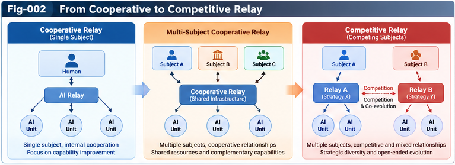

# CASE-002 — Open, Closed, and Hybrid Relay Strategies

## A Comparative Simulation Case for Competitive UIRTU-Relay, Strategic Advantage Maps, and Governed Structural Evolution

**Authors:** Sizhe Tan & GPT-Obot  
**Project:** Strategic Structural Intelligence and Competitive UIRTU-Relay (SSICR)  
**Version:** 1.0.0  
**Status:** Research case and falsifiable simulation design; no empirical results claimed  
**Date:** 2026-10-26

---

## Abstract

Should an intelligent organization expose its capabilities and interfaces to a broader ecosystem, protect them within an integrated boundary, or selectively combine both approaches? There is no context-free answer. Openness can accelerate knowledge diffusion, external discovery, interoperability, and ecosystem growth; closure can improve coordination, accountability, intellectual-property protection, and control over sensitive assets; hybrid arrangements can capture complementary advantages but introduce governance, interface, and switching costs. Moreover, the relative value of these choices changes as competitors learn, collaborators defect, standards emerge, and institutions evolve.

This case defines a controlled, reproducible research program comparing **open**, **closed**, and **hybrid** UIRTU-Relay strategies across heterogeneous strategic subjects. It specifies subjects, authority boundaries, strategy contracts, environmental regimes, adversarial adaptations, experimental protocols, multi-perspective scores, evidence records, and a Strategic Advantage Map (SAM). It treats strategies as configurable policies rather than fixed labels, and distinguishes simulated performance from real-world validation and legitimate authorization. Its principal claim is methodological: the appropriate output of massive multi-strategy simulation is not a universal winner, but a conditional map of advantages, failure boundaries, uncertainty, and governance tradeoffs.

**Keywords:** strategic structural intelligence; UIRTU-Relay; open strategy; closed strategy; hybrid strategy; comparative advantage; cross-play; adaptive opponents; multi-agent simulation; Strategic Advantage Map; human strategic sovereignty; counter-evidence.

---

## 1. Research Question and Scope

The central research question is:

> Under which combinations of capabilities, environmental conditions, counterpart strategies, institutions, and scoring perspectives do open, closed, or hybrid Relay arrangements yield a defensible comparative advantage?

The case asks four related questions:

1. Which benefits arise from **Relay topology**, rather than merely from differences in resource endowment or model capability?
2. When does a strategy that succeeds against static opponents fail against adapting opponents?
3. Can a hybrid strategy improve robustness across regimes without becoming too complex or costly?
4. How can the resulting knowledge inform a human decision maker without transferring strategic sovereignty to the optimizer?

This is a **research design**, not a report of completed experiments. Any numerical values below are illustrative parameters or hypothetical outcomes, never measurements of actual organizations.

## 2. Conceptual Grounding

SSICR treats a strategic subject as an entity with a persistent boundary, resources, capabilities, goals, evaluation perspectives, and authority over delegated actions. A **Relay** is a governed exchange or coordination relationship among such subjects or their intelligence units. A **UIRTU** is a composable intelligence unit participating in that structure; its implementation may be an LLM, retrieval system, simulation engine, scoring operator, specialized model, human workflow, or other contracted capability.

A strategic subject may use multiple Relay policies simultaneously. Thus, openness and closure are not intrinsic moral categories or immutable organizational identities. They are **choices about access, exchange, dependency, control, and exposure**, applied to specific interfaces and assets.

The case builds on `SSICR-001` through `SSICR-010`, and operationalizes the contracts in `SPEC-001` through `SPEC-004`.

## 3. Units of Analysis

We distinguish five units that should not be conflated:

| Unit | Description | Typical observables |
|---|---|---|
| Strategic subject | Organization or coalition holding goals and authority | Resource budget, utility perspectives, permissions |
| UIRTU | Reusable intelligence capability | Quality, latency, cost, provenance |
| Relay edge | Governed relationship between subjects or units | Access level, reciprocity, trust, revocation |
| Strategy policy | Rules for selecting and changing Relay edges | Disclosure, routing, licensing, fallback |
| Institutional regime | Rules governing interaction among subjects | Standards, enforcement, disclosure obligations |

A strategy's performance depends on the composition of these units. A Relay policy can improve knowledge acquisition while degrading information security, and the resulting tradeoff can differ by subject.

## 4. Three Strategy Families

### 4.1 Open Relay (O)

An open policy exposes eligible interfaces, protocols, or knowledge artifacts to a broad set of participants under explicit terms. Candidate mechanisms include public specifications, open evaluation data, interoperable APIs, permissive reuse, and community contributions.

**Potential advantages:** more external experiments, faster discovery, broad compatibility, reduced duplication, and diversified innovation sources.

**Potential liabilities:** free-riding, leakage of competitively sensitive information, uneven contribution quality, coordination burden, and greater exposure to adversarial exploitation.

Open does **not** mean unrestricted access to private data, unbounded authority, or automatic acceptance of unverified outputs.

### 4.2 Closed Relay (C)

A closed policy confines selected capabilities, artifacts, and coordination channels to a defined subject boundary or tightly controlled group.

**Potential advantages:** tighter integration, clearer responsibility, easier policy enforcement, stronger protection of sensitive assets, and lower external coordination complexity.

**Potential liabilities:** limited external feedback, duplicated effort, reduced interoperability, single-organization blind spots, and difficulty adapting to ecosystem-wide standards.

Closed does **not** imply zero external exchange: even a largely integrated organization may purchase services, license components, or participate in standards.

### 4.3 Hybrid Relay (H)

A hybrid policy partitions interfaces and artifacts into different exposure classes, possibly changing these classes with context.

Examples include open standards plus protected training data; public benchmarks plus private evaluation infrastructure; shared safety testing plus proprietary product optimization; or federated collaboration with restricted model weights.

**Potential advantages:** selective knowledge sharing, risk segmentation, strategic optionality, and resilience across changing conditions.

**Potential liabilities:** boundary misclassification, operational overhead, inconsistent incentives, policy complexity, and vulnerability at cross-boundary interfaces.

Hybrid is a **family of policies**, not a guaranteed compromise that dominates both alternatives.

---



---

## 5. Parameterizing Strategy Rather Than Using Labels Alone

Define a Relay policy vector:

$$
\pi = (o_k, o_i, o_e, a, r, v, d, q)
$$

where:

- $o_k$: knowledge artifact openness;
- $o_i$: interface openness;
- $o_e$: evaluation transparency;
- $a$: access-control strictness;
- $r$: reciprocity requirement;
- $v$: revocation and containment capability;
- $d$: dependency diversification;
- $q$: audit and quality-assurance intensity.

Each component may be continuous, ordinal, or categorical, but its type and scale must be declared in the experiment schema. Strategy families define **regions of policy space**, not single points.

A minimal experiment should include at least two configurations per family; otherwise a weakly chosen hybrid configuration could be mistaken for evidence against hybrid approaches in general.

## 6. Subjects and Initial Asymmetries

Consider four **synthetic** AI R&D organizations:

| Subject | Initial structural advantage | Main vulnerability | Illustrative priority |
|---|---|---|---|
| Atlas | Integrated compute and deployment | High fixed cost | Reliability and delivery |
| Beacon | Large contributor network | Coordination and quality variation | Discovery and reach |
| Cedar | Specialized evaluation and safety | Narrow deployment channel | Assurance and trust |
| Delta | Modular architecture and partner access | Cross-boundary overhead | Adaptability |

Names are fictional. To isolate the causal effect of Relay policy, conduct **both** asymmetric and resource-matched experiments. The first studies realistic heterogeneity; the second controls for confounding initial endowments.

Each subject retains its own scoring perspectives and action authority. The simulation cannot assume a single utility function that legitimately represents all subjects.

## 7. Environmental Regimes

At minimum, vary the following contextual axes:

1. **Knowledge volatility:** stable versus rapidly changing research frontier.
2. **Interface compatibility:** low versus high standardization.
3. **Information sensitivity:** low versus high exposure cost.
4. **Partner reliability:** reliable versus opportunistic or adversarial counterparties.
5. **Resource scarcity:** abundant versus constrained compute and human attention.
6. **Institutional enforcement:** weak versus credible contracts and audits.
7. **Network concentration:** distributed versus winner-take-most ecosystem.
8. **Evaluation difficulty:** observable short-term outcomes versus delayed, noisy outcomes.

A full factorial design is usually infeasible. Use stratified experimental designs, adaptive sampling, and explicit coverage accounting; do not extrapolate beyond tested regions without uncertainty labels.

## 8. Relay Topologies

Four topologies supply a tractable baseline:

```text
T0  Isolated:       A    B    C    D

T1  Open mesh:      A----B
                    | \/ |
                    | /\ |
                    C----D

T2  Closed hubs:    [A-A1-A2]   [B-B1-B2]

T3  Hybrid:         [A private]--public standard--[B private]
                          \----shared evaluation----/
```

Topology is a structural treatment variable, not a substitute for the underlying permission and exchange contracts. The same graph may produce different outcomes under different trust and audit policies.

## 9. Multi-Period Dynamics

At simulation step $t$, subject $i$ has state:

$$
X_{i,t}=(K_{i,t}, R_{i,t}, C_{i,t}, B_{i,t}, W_{i,t})
$$

with knowledge $K$, resources $R$, capabilities $C$, Relay boundaries $B$, and strategic worldview $W$.

Its strategy $\pi_{i,t}$ determines permissible exchange, capability acquisition, and adaptation. An environment transition function updates subject states and institutional rules:

$$
(X_{t+1}, I_{t+1}) = F(X_t, I_t, \boldsymbol{\pi}_t, \xi_t; \theta)
$$

where $I$ represents institutions, $\xi$ exogenous disturbances, and $\theta$ the declared simulation assumptions.

The model must make explicit whether agents observe true states, noisy signals, or only locally available evidence. Omniscient agents would bias conclusions about strategic learning.

## 10. Strategic Adaptation and Cross-Play

A static opponent test is insufficient. The protocol includes:

- **Self-play:** homogeneous strategy populations and adaptive variants.
- **Cross-play:** O against C, O against H, C against H, and mixed populations.
- **Best-response approximation:** bounded adaptation to observed competitor behavior.
- **Evolutionary population tests:** entry, exit, imitation, and coalition formation.
- **Adversarial stress tests:** deception, contribution withdrawal, interface breakage, and standard capture.
- **Regime shifts:** sudden changes in security exposure, regulation, or technical standards.

An apparently superior policy may owe its advantage to opponents that never adapt. Every SAM claim must identify the opponent adaptation class used in evaluation.

---


---

## 11. Multi-Perspective Scoring

Use a vector of outcomes rather than collapsing all goals into one unexamined score:

$$
\mathbf{Y}_{i}= (Q, V, L, S, A, D, G)
$$

where $Q$ is research quality, $V$ innovation velocity, $L$ long-run learning, $S$ security and safety, $A$ adaptability, $D$ dependency resilience, and $G$ governance compliance. Define units, direction, normalization, and missing-data rules for each metric.

Subject-specific evaluation may use:

$$
U_i(\pi,c,p) = \sum_{k} w_{i,k,p} \, \widetilde{Y}_{i,k}(\pi,c) - \lambda_i \mathrm{Risk}_i(\pi,c)
$$

where $p$ identifies the authorized scoring perspective. Weighted utility is **one optional decision model**, not a universal representation of value. Report Pareto dominance, individual metric outcomes, and constraints alongside any scalar score.

Do not treat a simulated utility maximum as authorization to execute a policy.

## 12. Comparative Advantage as a Conditional Claim

For two policies $\pi_a$ and $\pi_b$, define:

$$
\Delta_{a,b}(c,p,o,h)=
\mathbb{E}[U(\pi_a\mid c,p,o,h)]-
\mathbb{E}[U(\pi_b\mid c,p,o,h)]
$$

where $c$ is environmental context, $p$ scoring perspective, $o$ opponent model, and $h$ time horizon.

The expectation is meaningful only relative to a declared simulation distribution and model. A positive $\Delta$ supports a **conditional** advantage claim, not a universal ranking. Confidence intervals, model disagreement, and observed failure boundaries must accompany any reported sign.

## 13. Illustrative Hypotheses, Not Results

The following are hypotheses to test, not established findings:

| ID | Proposed condition | Candidate advantage | Critical counterexample |
|---|---|---|---|
| H1 | High knowledge volatility, low exposure cost | Open may learn faster | Contribution quality collapses |
| H2 | High sensitivity, strong integration economies | Closed may reduce exposure | Isolation causes critical blind spots |
| H3 | Mixed asset sensitivity, credible interfaces | Hybrid may improve robustness | Boundary management overwhelms gains |
| H4 | High interoperability, credible enforcement | Open or hybrid may scale | Standards captured by dominant actor |
| H5 | Unreliable partners, costly dependency | Closed or diversified hybrid may resist shocks | Internal single points of failure |
| H6 | Fast regime shifts | Adaptive hybrid may preserve options | Switching costs prevent timely response |

A scientifically useful negative result is one that identifies the condition invalidating a proposed advantage.

## 14. Hypothetical Demonstration Table

The following **fabricated values are for schema illustration only**. They are not experimental measurements, predictions, or estimates of real-world organizations. All scores use an arbitrary 0–100 scale.

| Regime | Open | Closed | Hybrid | Demonstration-only interpretation |
|---|---:|---:|---:|---|
| Fast knowledge turnover, low sensitivity | 82 | 63 | 77 | Open leads in this synthetic example |
| High exposure cost, stable interfaces | 57 | 84 | 78 | Closed leads in this synthetic example |
| Mixed sensitivity, changing standards | 70 | 65 | 85 | Hybrid leads in this synthetic example |
| Adversarial partners, weak enforcement | 49 | 76 | 69 | Closure may reduce some modeled exposure |

These numbers are deliberately **not** evidence for H1–H6. Replace the entire table with reproducible simulation outputs before making a performance claim.

## 15. Strategic Advantage Map Construction

A SAM should encode each advantage region with:

- subject and authorized perspective;
- policy family **and exact parameter configuration**;
- opponent configuration and adaptation assumptions;
- environmental constraints and horizon;
- comparator and metric definition;
- effect estimate and uncertainty;
- failure boundary and contradictory evidence;
- source run IDs and model versions;
- validation status and unresolved OTHERS;
- policy recommendation status, which remains separate from authorization.

Suggested map layers include: advantage region, robustness region, failure frontier, uncertainty layer, governance feasibility layer, and untested region.

---


---

## 16. Example SAM Record

```yaml
sam_record:
  schema_ref: "SPEC-003"
  claim_id: "SAM-HYBRID-EXAMPLE-001"
  status: "illustrative_not_validated"
  subject_id: "delta-synthetic"
  strategy:
    family: "hybrid"
    policy_version: "H-2"
    open_assets: ["interface-specifications", "non-sensitive-benchmarks"]
    restricted_assets: ["private-data", "deployment-credentials"]
    review_required_for_boundary_change: true
  comparator:
    strategy_family: "closed"
    policy_version: "C-1"
  context:
    knowledge_volatility: "high"
    information_sensitivity: "mixed"
    interoperability: "high"
    enforcement: "credible"
  opponent_model:
    adaptation_class: "bounded-best-response"
  scoring:
    perspective_id: "delta-authorized-rd"
    metrics: ["learning-rate", "exposure-loss", "coordination-cost"]
  outcome:
    advantage_direction: "hypothesized"
    effect_size: null
    confidence_interval: null
    validation_status: "not_tested"
  counter_evidence: []
  others:
    unresolved_factors: ["standard-capture", "partner-dependence"]
  governance:
    simulation_permission: "approved"
    deployment_permission: "not_granted"
```

A production record must conform to the exact canonical schema in `SPEC-003`; the YAML above is a conceptual example, not a claim of machine-validated conformance.

## 17. Experiment Design and Identification

A credible comparison must control for alternative explanations:

1. Match initial budgets and capabilities for controlled comparisons.
2. Randomize environmental seeds and initial network assignments where feasible.
3. Use **paired seeds** for policy comparisons to reduce variance.
4. Pre-register primary metrics and decision-relevant constraints.
5. Separate policy-search runs from held-out evaluation runs.
6. Run multiple model families or independent simulators when possible.
7. Preserve failed runs and report exclusions with reasons.
8. Report distributions and uncertainty, not only the best observed score.
9. Perform ablations for openness, access controls, audit costs, and topology.
10. Re-run results against adaptive and out-of-distribution opponents.

For observational real-world studies, causal attribution requires stronger designs than comparing successful open and closed organizations after the fact.

## 18. Compute Allocation and Search

The search space grows with policy granularity, number of subjects, opponent adaptation, institutional regime, and time horizon. A scalable implementation may use:

```text
Candidate policy generator
          |
          v
Cheap feasibility / authority filters
          |
          v
Coarse multi-agent simulations
          |
          v
Uncertainty- and disagreement-aware allocation
          |
          v
High-fidelity adversarial cross-play
          |
          v
Held-out validation + counter-evidence
          |
          v
Versioned Strategic Advantage Map
```

Adaptive allocation should prioritize decision-sensitive uncertainty, poorly sampled boundaries, and competing hypotheses, not merely high-scoring candidates. Reserve a fixed evaluation budget to prevent adaptive search from contaminating the test set.

## 19. Switching Costs and Path Dependence

A major pitfall is treating open, closed, and hybrid as frictionless options. A subject may accumulate technical debt, contractual commitments, trust relationships, interface dependencies, or institutional obligations that constrain future choices.

Model transition costs explicitly:

$$
J_i(\pi_{t}\rightarrow\pi_{t+1}) =
J_{technical}+J_{contractual}+J_{organizational}+J_{trust}
$$

A policy with higher instantaneous score may have lower long-run value after switching costs. Conversely, a hybrid policy can be useful as a real option only when switching is technically and institutionally feasible.

## 20. Strategic Externalities and Social Welfare

Private advantage and collective outcomes can diverge. Openness might improve ecosystem learning while reducing a focal subject's appropriable returns; closure might preserve accountability but impede shared verification; hybrid governance can shift burdens to weaker participants.

Therefore, report **three separate levels**:

- subject-level outcomes and sovereignty;
- network-level outcomes, including access and resilience;
- institution- or society-level outcomes, including public risks and concentration.

Do not convert one subject's utility into a normative statement about what all participants should value. Distributional impacts require explicit representation.

## 21. Worldview Formation from Relay Evidence

A repeated SAM finding can become a candidate strategic principle, for example:

> Under credible interoperability and low sensitivity, open evaluation exchange may improve collective discovery, provided contribution quality and capture risks remain controlled.

This principle is **conditional**, evidence-linked, and revisable. It should not be generalized into “openness is always best.” A worldview forest may contain competing principles, such as an assurance-first view, an ecosystem-growth view, or an autonomy-first view, each with different authorized scoring priorities.

The workflow is:

```text
Simulation traces
    -> evidence-qualified advantage claims
    -> conditional strategic principles
    -> plural worldview trees
    -> new policy hypotheses
    -> further adversarial simulation
```

This is a feedback loop, not a one-way conversion of simulated performance into ideology.

## 22. Counter-Evidence, OTHERS, and Anti-Goodhart

Every favored policy should face explicit attempts at refutation. At minimum, test:

- selective publication of favorable simulation runs;
- strategic gaming of reported research productivity;
- hidden security exposure and delayed losses;
- unmodeled partner motives or tacit collusion;
- distribution shift and adversarial adaptation;
- standard capture and network centralization;
- dependence on a particular simulator's assumptions;
- metric substitution for the subject's actual goals.

Record unresolved factors in an **OTHERS** evidence space rather than forcing every observation into existing categories. A novel residual may justify a new policy dimension, scenario type, or institutional model.

A negative or inconclusive result is a legitimate contribution to the map.

## 23. Human Strategic Sovereignty

The experiment engine may generate policies, rank options, and suggest new Relay structures. It must not independently:

- change a subject's fundamental goals;
- expose restricted data or capabilities;
- enter binding real-world contracts;
- change the authorized risk tolerance;
- initiate real-world adversarial actions;
- treat simulator preferences as the subject's values.

Any real deployment requires an explicit authority contract, responsible approver, revocation path, and audit record. A strategic recommendation should present alternative policies, uncertainties, counter-evidence, and tradeoffs—not a single opaque winner.

## 24. Proposed Experimental Workflow

**Phase A — Contract and baseline.** Define subjects, policy spaces, authority boundaries, metrics, and a non-adaptive reference simulator.

**Phase B — Matched comparisons.** Compare multiple O/C/H configurations under paired environmental seeds and matched resource endowments.

**Phase C — Competitive adaptation.** Introduce best-response, evolutionary, and coalition-forming opponents.

**Phase D — Institutional dynamics.** Allow standards, enforcement, and exchange norms to change endogenously.

**Phase E — Map construction.** Produce versioned SAM records with uncertainty, failures, provenance, and OTHERS.

**Phase F — Independent validation.** Test held-out regimes, alternative simulators, and, where authorized and feasible, limited observational or field evidence.

**Phase G — Governed decision support.** Present decision dossiers for human review; record whether proposed strategic actions were authorized, rejected, or deferred.

## 25. Reproducibility Package

A publishable experimental extension should include:

```text
experiments/case-002/
  README.md
  subject-contracts/
  policy-configurations/
  scenario-matrix.yaml
  scoring-perspectives.yaml
  random-seeds.txt
  simulator-version.txt
  baseline-runs/
  cross-play-runs/
  ablations/
  held-out-tests/
  counter-evidence/
  sam-records/
  evaluation-report.md
```

This is a **proposed future layout**; these experiment files are not supplied by this case study. The present repository may remain a research-and-specification release without executable code.

## 26. Falsifiable Hypotheses

**H-OC-01 — Context dependence.** No single fixed O/C/H configuration dominates all tested regimes on every authorized scoring perspective.

**H-OC-02 — Adaptive-opponent reversal.** At least some advantages observed against static opponents shrink or reverse against adaptive opponents.

**H-OC-03 — Selective boundary value.** In mixed-sensitivity environments, well-governed hybrid partitioning can outperform indiscriminate openness on a constrained security–learning frontier.

**H-OC-04 — Governance overhead.** Hybrid benefits decrease when audit, integration, and switching costs exceed the value of selective sharing.

**H-OC-05 — Advantage map transfer.** Contextual SAM-based policy selection generalizes better to held-out regimes than selection based on global average strategy scores, when context measurements are informative.

**H-OC-06 — Evidence-aware calibration.** Explicit counter-evidence and model disagreement improve uncertainty calibration of SAM advantage claims.

**H-OC-07 — Institutional feedback.** Endogenous changes in standards or enforcement shift the boundaries between open, closed, and hybrid advantage regions.

**H-OC-08 — Sovereign decision quality.** Human reviewers receiving multi-perspective SAM dossiers identify more relevant tradeoffs and unjustified certainty than reviewers receiving only a top-ranked strategy, subject to measured cognitive cost.

Each hypothesis may fail. Failures should trigger model revision rather than reinterpretation as inevitable support.

## 27. Evaluation Metrics and Decision Thresholds

| Evaluation target | Candidate measure | Required safeguard |
|---|---|---|
| Comparative advantage | Paired outcome difference | Confidence intervals and comparator |
| Robustness | Worst-regime or lower-tail performance | Explicit tested regime set |
| Adaptability | Recovery after regime shift | Switching costs included |
| Security | Exposure events and loss severity | Threat model documented |
| Learning | Validated capability improvement | Independent assessment |
| Ecosystem effects | Contribution diversity and concentration | Distributional reporting |
| SAM reliability | Calibration and held-out sign accuracy | Leakage-free test set |
| Governance | Unauthorized action count | Authority logs and audit |
| Human comprehension | Tradeoff recall and error detection | Cognitive load measurement |

Decision thresholds must be established by authorized stakeholders before outcome inspection when they will govern real choices.

## 28. Failure Modes and Limitations

**Simulator realism.** Strategic behavior in real organizations depends on culture, incentives, legal institutions, tacit knowledge, and historical relationships that a model may omit.

**Endogenous preferences.** Goals and worldviews can change during competition; fixed utilities can miss this evolution, while unrestricted utility revision can violate sovereignty.

**Scale and tractability.** Full multi-agent strategic search may be computationally intractable; approximation can distort rankings.

**Measurement bias.** Innovation quality, trust, and safety are hard to reduce to scalar metrics.

**External validity.** Results in synthetic AI R&D settings do not automatically transfer to national security, public governance, or whole societies.

**Strategic manipulation.** Subjects may deliberately conceal intentions or influence measurements.

**Institutional capture.** Openness may coexist with concentration of effective control; labels alone are insufficient.

The case is strongest as a disciplined **comparative research scaffold**, not as a forecasting oracle.

## 29. Cross-Document Traceability

| Case element | Principal SSICR reference |
|---|---|
| Strategic subjects and Relay boundaries | `SSICR-002`; `SPEC-001` |
| Scoring and control planes | `SSICR-003` |
| Massive multi-strategy simulation | `SSICR-004`; `SPEC-002` |
| Comparative advantage maps | `SSICR-005`; `SPEC-003` |
| Worldview forests and counter-evidence | `SSICR-006`; `SPEC-004` |
| Social and institutional co-evolution | `SSICR-007` |
| Human strategic sovereignty | `SSICR-008` |
| Open-ended strategic RSI | `SSICR-009` |
| Unified architecture | `SSICR-010` |
| Competitive AI R&D subject model | `CASE-001` |

The next case, `CASE-003-Strategic-Worldview-Evolution.md`, examines how conditional advantage claims are promoted, contested, revised, and governed as strategic worldview structures.

## 30. Conclusion

The open-versus-closed question is poorly posed when treated as a universal ideological contest. A more useful research question is **which Relay configuration provides which advantages, for which subject, under which constraints, against which adaptive opponents, and with what evidence**.

SSICR proposes that large-scale competitive simulation can support this inquiry by exploring many strategy configurations, identifying context-sensitive advantage regions, and exposing their failure boundaries. But simulations do not confer normative authority: strategy selection remains perspective-dependent, evidence remains revisable, and real-world action remains governed by the relevant strategic subject.

The intended product is therefore not an automated verdict that openness, closure, or hybridity always wins. It is a **versioned, counter-evidence-aware Strategic Advantage Map** that enlarges the space of informed and sovereign strategic choice.

---

## Research Context and Further Reading

This case connects to established research traditions including agent-based modeling, multi-agent reinforcement learning, evolutionary game theory, mechanism design, organizational economics, network science, causal experimental design, robust optimization, and simulation-based policy analysis. These are methodological connections, not claims that any one literature validates SSICR's proposed architecture. Empirical references should be added only after source verification.

## Citation

Tan, Sizhe, and GPT-Obot. (2026). *CASE-002: Open, Closed, and Hybrid Relay Strategies*. Strategic Structural Intelligence and Competitive UIRTU-Relay (SSICR), version 1.0.0. Research case study. DOI pending.
