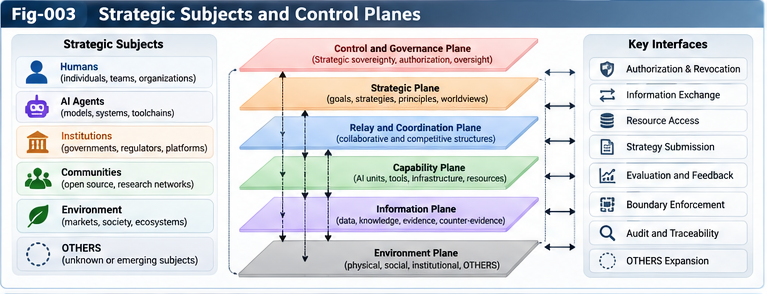

# SSICR-003 — Strategic Control Planes and Scoring

**Project:** Strategic Structural Intelligence and Competitive UIRTU-Relay (SSICR)  
**Version:** 1.0.0 — Research framework proposal  
**Authors:** Sizhe Tan & GPT-Obot  
**Status:** Conceptual architecture; hypotheses and interfaces require empirical validation

## Abstract

Competitive UIRTU-Relay systems contain multiple strategic subjects with different objectives, information, resource constraints, and decision rights. A single global optimizer cannot faithfully represent these differences. This paper proposes a **Strategic Control Plane (SCP)** for each subject and a perspective-aware **Strategic Scoring Forest** for evaluating candidate strategies across contexts, opponents, and time horizons. SCP separates authorized objectives and non-negotiable constraints from revisable beliefs, models, and strategies. The architecture connects strategy generation, relay selection, simulation, counter-evidence, human authorization, and structural learning. Rather than asserting a universally optimal strategy, the framework produces conditional comparisons and evidence-linked **Strategic Advantage Maps**. We specify conceptual contracts, illustrative equations, failure modes, and testable hypotheses for competitive AI research-and-development simulations.

**Keywords:** strategic control plane; UIRTU-Relay; strategic scoring forest; multi-agent competition; comparative advantage map; scoring sovereignty; counter-evidence; strategic governance

---



---

## 1. Scope and Position

SSICR-001 generalized relay relationships beyond voluntary cooperation. SSICR-002 defined strategic subjects and relay boundaries. This paper addresses the next question: **How does a strategic subject evaluate, select, authorize, and revise relay strategies when other subjects may react strategically?**

The answer is not to enlarge an ordinary task dispatcher. Strategic choice introduces partially observable opponents, endogenous changes in their behavior, multiple objectives, and governance boundaries. An SCP is a proposed functional architecture, not a claim that any existing AI system already implements it.

This paper does not supply validated predictions about real companies, governments, or military organizations. Its examples are synthetic and intended for reproducible experiments.

## 2. Definitions

- **Strategic subject:** An identifiable decision-making entity with objectives, resources, authorized action boundaries, and accountable governance.
- **UIRTU-Relay:** A composable arrangement of intelligence units and their exchanges, including information, delegation, execution, feedback, and structural revision.
- **Strategy:** A conditional policy for selecting actions and relay configurations across states and time, rather than a single fixed action.
- **Strategic Control Plane (SCP):** The subject-owned layer that maintains objectives and constraints, coordinates models and scoring, chooses relay configurations, and authorizes consequential actions.
- **Strategic Scoring Forest (SSF):** A collection of perspective- and context-specific evaluators that preserve trade-offs and uncertainty instead of collapsing all outcomes into one universal score.
- **Strategic Advantage Map (SAM):** A versioned record of which strategies perform relatively well in specified contexts, against specified opponent models, under stated metrics and evidence.
- **Scoring sovereignty:** The principle that a subject's legitimate authority over objectives, preferences, and action permissions is not automatically delegated through technical relay connections.

## 3. Why Ordinary Control Planes Are Insufficient

A task control plane may ask: *Which tool can complete this request fastest?* A strategic control plane must also ask: *How will other subjects react, what future options are lost, and who is authorized to accept the resulting risk?*

Three distinctions matter:

1. **Capability versus incentive:** A technically capable relay partner may have conflicting interests.
2. **Local efficiency versus strategic consequence:** An inexpensive action may induce an expensive response or lock-in.
3. **Optimization versus authority:** A strategy with high simulated utility may still violate privacy, contractual, or governance constraints.

Therefore, strategy scoring must be coupled to both a subject model and a governance mechanism.

## 4. Strategic Control Plane Architecture

A proposed SCP contains seven interacting modules:

1. **Objective and Sovereignty Registry:** Stores authorized objectives, value priorities, permissions, and immutable or approval-gated boundaries.
2. **Situation and Evidence Model:** Tracks observed environment states, uncertainty, source provenance, and unresolved OTHERS factors.
3. **Opponent and Partner Models:** Maintains multiple hypotheses about other subjects' goals, capabilities, and possible adaptations.
4. **Strategy and Relay Generator:** Proposes candidate policies, unit compositions, partner relationships, and contingency plans.
5. **Strategic Scoring Forest:** Evaluates candidates under several perspectives, scenarios, and horizons.
6. **Simulation and Counter-Evidence Gateway:** Sends candidates to sandbox experiments, adversarial stress tests, and independent model critics.
7. **Decision, Authorization, and Learning Gateway:** Separates recommendations from executable decisions, records approvals, and updates revisable models from evidence.

### 4.1 Logical information flow

```text
Authorized Subject Objectives + Constraints
                   |
                   v
Situation Model <--> Opponent / Partner Models
                   |
                   v
        Strategy + Relay Generator
                   |
                   v
         Strategic Scoring Forest
                   |
                   v
 Simulation / Stress Test / Counter-Evidence
                   |
                   v
    Strategic Advantage Map + Uncertainty
                   |
                   v
        Human / Authorized Governance
                   |
                   v
          Bounded Relay Execution
                   |
                   v
       Observation, Audit, Model Revision
                   +------> Situation / Scoring / Strategy
```

**Figure insertion:** `../figures/Fig-003-Strategic-Subjects-and-Control-Planes.png` may be inserted after this section once created. It should distinguish subject-owned control planes from shared relay infrastructure.

## 5. Subject-Specific Scoring Forests

In a multi-subject environment, there is no presumption of a single objective function. Subject *i* maintains a set of evaluators indexed by perspective *p*, scenario *c*, and horizon *h*:

\[
\mathcal{F}_i = \{ S_{i,p,c,h} : (\pi,\omega) \mapsto (v,u,e) \},
\]

where \(\pi\) is a candidate strategy, \(\omega\) is a simulated outcome, \(v\) is a score or vector of scores, \(u\) describes uncertainty, and \(e\) references supporting evidence.

Representative scoring perspectives include:

| Perspective | Illustrative measurements | Typical tension |
|---|---|---|
| Mission success | Task completion, research progress | May increase cost |
| Resource efficiency | Compute, capital, time | May reduce redundancy |
| Resilience | Recovery, graceful degradation | May reduce short-term speed |
| Strategic flexibility | Switching cost, retained options | May require unused capacity |
| Trust and compliance | Contract conformance, privacy | May restrict information sharing |
| Long-horizon value | Sustained capability and welfare | Sensitive to forecasting assumptions |

An SSF should retain raw measurements and their provenance. Weighted scalar scores may be used for an explicitly declared decision perspective, but weights must not be presented as objective truths.

## 6. Contextual Strategy Evaluation

Let \(\pi_i\) be subject *i*'s strategy, \(\boldsymbol{\pi}_{-i}\) the strategies of other subjects, \(c\) the environment, and \(h\) the evaluation horizon. A contextual performance measure is:

\[
V_i(\pi_i\mid c,\boldsymbol{\pi}_{-i},h,\theta_i),
\]

where \(\theta_i\) represents authorized scoring preferences. Since opponents are not fully known, evaluation uses an ensemble of opponent hypotheses \(q\):

\[
\widehat V_i(\pi_i\mid c,h)
= \mathbb E_{\boldsymbol{\pi}_{-i}\sim q}
\left[V_i(\pi_i\mid c,\boldsymbol{\pi}_{-i},h,\theta_i)\right].
\]

This expectation is a modeling convenience, not a guarantee that the distribution \(q\) is correct. Robust alternatives should test worst-case or distribution-shifted opponents.

For two strategies \(a\) and \(b\), a conditional advantage estimate is:

\[
\Delta_i(a,b\mid c,h,q)
= \widehat V_i(a\mid c,h,q)-\widehat V_i(b\mid c,h,q).
\]

Positive \(\Delta_i\) indicates an advantage *under the stated model and scoring perspective*, not a universal superiority claim. This usage of comparative advantage is broader than the strict opportunity-cost definition in classical trade theory.

## 7. Strategy Selection Is Not a Single Argmax

Selection may be multi-objective, constraint-aware, and uncertainty-sensitive. An illustrative policy is:

\[
\pi_i^* \in \operatorname{ParetoFront}
\left\{\mathbf V_i(\pi): \pi\in\Pi_i,\; g_i(\pi)\leq 0\right\},
\]

where \(g_i\) represents authorized constraints. The result is a set of non-dominated candidates, not necessarily one winning strategy.

A decision gateway can then expose a short list with:

- Performance ranges across scenarios and horizons.
- The opponent assumptions that drive each result.
- Resource costs, reversibility, and switching costs.
- Known counterexamples and out-of-distribution failures.
- Required human or organizational approvals.

The SCP must preserve a distinction between **recommendation**, **authorization**, and **execution**.

## 8. Relay Configuration as a Strategic Decision

The strategy space includes not only what to do, but **how intelligence is organized**. Candidate relay configurations may vary along:

- Centralized versus distributed research units.
- Internal execution versus delegated or purchased capabilities.
- Closed versus open knowledge exchange.
- Parallel exploration versus sequential specialization.
- Redundancy, failover, and independence among evaluators.
- Temporary alliances and contract-governed collaboration.

A relay configuration changes information flow, dependency risk, resource cost, and future options. Therefore, the SCP should score strategy-policy pairs \((\pi,r)\), where \(r\) is a relay architecture, rather than treating architecture as fixed background infrastructure.

## 9. Multi-Horizon Scoring and Option Preservation

A short-horizon strategy may win immediate tasks while undermining future adaptability. Scoring should therefore distinguish immediate, medium-term, and long-term outcomes.

An illustrative discounted utility is:

\[
J_i(\pi)=\mathbb E\left[\sum_{t=0}^{T}\gamma_i^t u_i(s_t,a_t)\right],
\]

but the scalar expression is insufficient by itself: scenario uncertainty, rare catastrophic outcomes, strategic dependency, and non-compensable constraints must be reported separately.

A useful additional metric is **option preservation**: the degree to which a strategy leaves the subject able to switch partners, architectures, or objectives under legitimate future governance. It is a proposed measurable construct, not a settled universal metric.

## 10. Opponent Modeling and Strategic Adaptation

Static opponent models are inadequate for repeated competition. The SCP should evaluate candidate strategies against multiple adaptive opponent policies:

- Fixed baseline policies.
- Best-response approximations.
- Learning agents that revise strategies after observing outcomes.
- Cooperative or coalition-forming agents.
- Adversarial stress-test agents seeking weaknesses in the subject's plan.

Care is needed: training against a narrow opponent population can produce brittle exploitative behavior. Holdout opponents and independently designed scenarios are required for meaningful robustness claims.

## 11. Strategic Advantage Map Interface

The SSF does not end with a leaderboard. It emits evidence-linked records that can later populate a Strategic Advantage Map. An illustrative record is:

```yaml
advantage_record_id: SAM-EXAMPLE-001
subject_id: org-a
strategy_id: hybrid-research-relay-v2
relay_configuration_id: relay-hybrid-02
context:
  compute_budget: medium
  environment_volatility: high
  cooperation_permissions: bounded
opponent_ensemble: opponent-set-03
horizon: medium_term
scoring_perspective: resilience_and_cost
comparison_baseline: centralized-relay-v1
outcome:
  relative_advantage: pending_experiment
  confidence_interval: null
  robustness_status: untested
counter_evidence: []
provenance:
  simulator_version: pending
  experiment_id: pending
  random_seed: null
status: illustrative_schema_not_empirical_result
```

The map should preserve **advantage regions**, **failure boundaries**, and **unresolved evidence**, not just the highest score.

## 12. Cross-Subject Relay and Scoring Sovereignty

Subject A may use a relay service operated by Subject B without transferring authority over A's strategic objectives. A valid cross-subject contract should declare:

- Service purpose and allowed outputs.
- Data-sharing and retention boundaries.
- Permitted learning and model-update uses.
- Delegation scope and action limits.
- Auditability, exit conditions, and dispute handling.

Shared infrastructure can support common measurement standards without forcing common value weights. A governance layer may enforce shared safety and legal constraints while allowing distinct legitimate subject preferences.

## 13. Counter-Evidence, Anti-Goodhart, and Evaluator Governance

Massive simulation can amplify evaluator defects. A candidate may score highly because it exploits a simulator loophole rather than because it is robust in the target environment. The proposed safeguards are:

1. **Evaluator diversity:** Distinct scoring methods and independently specified metrics.
2. **Adversarial counterexamples:** Deliberate searches for contexts where a candidate fails.
3. **Holdout scenarios:** Unseen environments and opponent models.
4. **Model criticism:** Checks of simulation assumptions, omitted variables, and OTHERS evidence.
5. **Provenance and reproducibility:** Versions, seeds, data sources, and complete evaluation settings.
6. **Governance gates:** Human approval for changes to protected objectives or consequential actions.

A higher simulated score is evidence about a model, not automatic permission to act in the world.

## 14. Illustrative Case: Three Competitive AI R&D Subjects

Consider three fictional research organizations operating under a shared compute budget constraint:

| Subject | Initial strategic preference | Candidate relay design |
|---|---|---|
| A | Concentrated execution efficiency | Centralized specialist agents |
| B | Breadth of exploration | Distributed parallel research agents |
| C | Flexibility and bounded collaboration | Hybrid internal/external relay |

A controlled simulation varies budget, task uncertainty, opponent learning rates, and information-sharing rules. Each subject's SCP evaluates its own outcomes using disclosed scoring preferences. Researchers then compare fixed and adaptive strategies across held-out environments.

**Research question:** Under what conditions does a hybrid relay outperform centralized or distributed alternatives after accounting for switching costs, opponent adaptation, and model uncertainty?

No empirical winner is claimed here. The example defines a testable design, not observed findings.

## 15. Testable Hypotheses

**H1 — Context dependence.** Different relay architectures dominate in different resource, uncertainty, and opponent conditions; a single global winner is uncommon across a sufficiently diverse test suite.

**H2 — Multi-horizon reversal.** Rankings derived from short-horizon scores differ materially from rankings under longer horizons in environments with switching costs and adaptive opponents.

**H3 — Scoring-forest value.** Multi-perspective scoring with explicit uncertainty yields more robust strategy shortlists than a single fixed weighted score under held-out shifts.

**H4 — Counter-evidence value.** Adversarial scenario generation reduces out-of-distribution failures compared with equal-budget random scenario evaluation.

**H5 — Sovereignty enforcement.** Explicit approval gates and contract boundaries reduce unauthorized cross-subject actions without eliminating all useful collaboration.

Each hypothesis requires pre-registered metrics, comparable compute budgets, multiple seeds, and null-result reporting.

## 16. Validation Roadmap

**Phase A — Minimal reproducible environment.** Build synthetic AI R&D subjects, fixed task distributions, a small strategy set, and transparent scoring baselines.

**Phase B — Adaptive competition.** Introduce learning opponents, resource constraints, relay rewiring, and scenario shifts. Compare static versus adaptive control planes.

**Phase C — Advantage mapping.** Generate conditional strategy comparisons with uncertainty estimates, counterexamples, and provenance.

**Phase D — Human-governed decisions.** Test whether advantage-map summaries help authorized decision-makers choose more robust strategies while understanding uncertainty and constraints.

Metrics should include task quality, compute cost, variance, regret against declared baselines, failure frequency, calibration, constraint violations, and human comprehension. Report sensitivity to simulator fidelity and behavioral assumptions.

## 17. Limitations and Open Questions

- How can subject objectives be represented without oversimplifying human institutions?
- Which strategic preferences are learnable, and which must remain approval-gated?
- How should scoring forests handle incommensurable values?
- When does opponent modeling improve robustness rather than encourage overfitting?
- How can simulated advantage be externally validated?
- Can worldviews be learned from maps without collapsing into a single dogmatic policy?
- What is the minimum simulation fidelity needed for actionable recommendations?

The framework does not claim to solve equilibrium selection, real-world causal identification, or open-ended social prediction. It is a proposal for structured experimentation.

## 18. Connections to the SSICR Research Program

- **SSICR-001:** Generalized cooperative, competitive, and adversarial relay relations.
- **SSICR-002:** Strategic subjects, boundaries, and sovereignty.
- **SSICR-004:** Large-scale multi-strategy simulation and adaptive compute allocation.
- **SSICR-005:** Strategic comparative advantage maps.
- **SSICR-006:** Strategic worldview forests and principle extraction.
- **SSICR-008:** Human strategic sovereignty and authorization.
- **SPEC-001/002/003/004:** Proposed contracts and evidence schemas.

Conceptual antecedents within the broader Structural Intelligence research program include UCPSF's control planes and scoring forests, SSI's subject boundary and scoring sovereignty, SIF's contracts and counter-evidence, and structural RSI's evaluator governance. These are architectural connections, not independent empirical validation.

## 19. Conclusion

Strategic Control Planes generalize task-oriented relay management into subject-owned, multi-horizon, opponent-aware strategic choice. Their purpose is not to identify a universal winning policy, but to organize evidence about **which strategies and relay structures have conditional advantages, under which assumptions, with which failure modes, and subject to whose authority**.

The proposed architecture places Scoring Forests between open-ended strategy generation and governed action. Large-scale simulation can explore more possibilities than direct human review, while Strategic Advantage Maps preserve the distinctions needed for accountable judgment. The central design principle is therefore:

> **AI may expand the space of strategic possibilities; it must not silently inherit the subject's authority to decide which future to pursue.**

---

**Suggested citation:** Tan, S., & GPT-Obot. (2026). *SSICR-003: Strategic Control Planes and Scoring* (Version 1.0.0). Strategic Structural Intelligence and Competitive UIRTU-Relay research repository. DOI pending.

**License:** Refer to the repository's `LICENSE.txt` file.  
**Document status:** Research proposal; not an operational strategic decision system.
