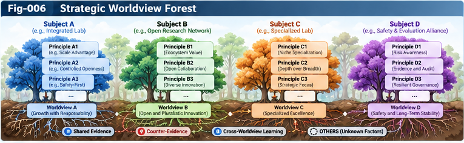

# SSICR-006 — Strategic Worldview Forests

## From Comparative Advantage Maps to Perspective-Aware Strategic Principles and Governed Worldview Evolution

**Project:** Strategic Structural Intelligence and Competitive UIRTU-Relay (SSICR)  
**Authors:** Sizhe Tan & GPT-Obot  
**Version:** 1.0.0  
**Status:** Research framework and testable hypotheses; not an empirically validated general theory  
**Date:** 2026-10-22

---

## Abstract

Large-scale multi-strategy UIRTU-Relay simulation can generate enormous volumes of context-dependent evidence about strategies, opponents, environments, and failure boundaries. Yet a Strategic Comparative Advantage Map (SAM) alone does not determine what a strategic subject should value, which evidence it should seek, or how it should revise its beliefs. This paper proposes **Strategic Worldview Forests (SWFs)**: plural, perspective-aware, versioned structures that organize strategic world models, conditional principles, evaluation preferences, uncertainty, and counter-evidence. A forest preserves competing explanatory and normative perspectives instead of prematurely collapsing them into a universal winning strategy or ideology. We specify a map-to-principle-to-worldview pipeline, distinguish empirical belief revision from changes to authorized goals, introduce counter-evidence and provenance requirements, and outline a controlled AI R&D simulation benchmark. The intended result is not autonomous replacement of human strategic judgment, but interpretable, contestable, and revisable strategic knowledge that expands human choice.

**Keywords:** Strategic Worldview Forest; Strategic Advantage Map; UIRTU-Relay; Strategic Structural Intelligence; Scoring Forest; perspective-aware optimization; principle extraction; multi-agent simulation; counter-evidence; human strategic sovereignty.

## 1. Research Position and Scope

This is the sixth core paper in SSICR. SSICR-001 generalizes cooperative relay into competitive and adversarial relations; SSICR-002 specifies strategic subjects and boundaries; SSICR-003 introduces strategic control planes and scoring; SSICR-004 develops massive multi-strategy simulation; SSICR-005 defines contextual Strategic Comparative Advantage Maps (SAMs). The present paper addresses the next transition:

> How can many local, uncertain, and sometimes contradictory strategic comparisons become a persistent yet revisable system for perceiving, evaluating, and acting in a changing multi-subject world?

The proposal is an architectural research hypothesis. It does not claim that worldview formation is fully computable, that simulated social behavior is a reliable prediction of reality, or that any model may unilaterally change a human principal's goals.

## 2. Why a Strategic Advantage Map Is Not Yet a Worldview

A SAM answers a bounded comparative question: under context *c*, against opponent model *o*, over horizon *h*, which strategies exhibit which performance distributions and failure modes? A strategic worldview additionally specifies:

1. **Perception:** what features and missing evidence merit attention;
2. **Causal interpretation:** which mechanisms may explain observed outcomes;
3. **Valuation:** which outcomes matter to a particular subject;
4. **Strategic orientation:** which principles guide candidate generation and selection;
5. **Epistemic discipline:** how confidence, disagreement, and counter-evidence are handled;
6. **Revision:** when and how beliefs or principles change;
7. **Authority:** who may approve changes to values, goals, and action limits.

A SAM is therefore evidence infrastructure for a worldview, not a sufficient generator of legitimate values. Two subjects can use the same SAM and reach different authorized decisions.

## 3. Operational Definitions

**Strategic world model:** a provisional representation of actors, capabilities, resources, incentives, institutions, causal mechanisms, uncertainty, and environmental dynamics.

**Strategic principle:** a conditional, defeasible proposition connecting context, mechanism, action pattern, expected consequences, and limits of applicability.

**Strategic worldview:** a persistent configuration of world-model hypotheses, strategic principles, evaluation perspectives, and revision rules used by a strategic subject to interpret and choose among possible actions.

**Strategic ideology:** in this technical framework, a relatively durable orientation of principles and valuation preferences. The term is descriptive, not an endorsement of rigid political doctrine. Ideology must be distinguishable from evidence, assumptions, and authorized objectives.

**Strategic Worldview Tree:** a coherent, traceable perspective or family of conditional principles with explicit scope and counter-evidence.

**Strategic Worldview Forest (SWF):** a governed collection of such trees, preserving disagreement, alternative causal explanations, different value perspectives, and branches that remain unresolved.

**Worldview sovereignty:** the principle that the legitimate subject or its authorized governance process retains authority over normative commitments and consequential decisions; an optimizing subsystem does not acquire that authority through relay.

## 4. A Canonical Worldview Tree

A tree should not be mistaken for a single scalar reward function. Its suggested components are:

- **Tree identity and ownership:** identifier, version, subject, authorized purpose;
- **Perspective:** stakeholder and value lens;
- **World-model assumptions:** causal claims, opponent models, institutional conditions;
- **Perception policy:** signals to observe, blind spots, uncertainty triggers;
- **Principle set:** conditional strategic rules and rationale;
- **Evidence links:** SAM regions, simulation runs, empirical observations;
- **Counter-evidence:** disconfirming cases and unresolved anomalies;
- **Decision interface:** candidate strategy constraints and ranking explanations;
- **Revision policy:** thresholds, tests, approvals, rollback;
- **Boundary contract:** information, action, learning, and governance limits.

A forest is not required to merge inconsistent trees. Contradictions can be informative evidence about context dependence, model misspecification, or normative pluralism.

## 5. Map → Principle → Worldview: A Traceable Pipeline

The proposed pipeline is:

```text
Simulation traces / external observations
                 |
                 v
Strategic Advantage Maps (context, outcomes, uncertainty)
                 |
                 v
Candidate mechanisms and conditional principles
                 |
          Counter-evidence tests
                 |
                 v
Principle registry with provenance and applicability bounds
                 |
                 v
Perspective-specific Worldview Trees
                 |
                 v
Strategic Worldview Forest
                 |
                 v
Governed strategy generation, scoring and UIRTU-Relay selection
                 |
                 +------> new observations / map revisions
```

**Stage A — Evidence consolidation.** Group comparable outcomes while retaining simulation version, opponents, seeds, sampling design, and uncertainty. Avoid pooling incompatible environments.

**Stage B — Mechanism hypotheses.** Propose *why* a strategy performed well; separate correlation from causal claims. Compare competing explanations.

**Stage C — Conditional principle extraction.** State a principle with explicit antecedents, expected effect, disconfirming conditions, and confidence. Reject unsupported universalization.

**Stage D — Forest integration.** Assign principles to compatible perspectives; allow overlap, conflict, or branching rather than forced consensus.

**Stage E — Governed deployment.** Use trees to suggest, rank, or challenge strategies under authorized goals and limits. Require appropriate review for consequential actions.

**Stage F — Revision.** Incorporate new evidence; log changed beliefs, retained disagreements, and authorization decisions.

---



*Figure 6. From contextual strategic advantage evidence to plural, revisable worldview trees and governed strategic relay.*

---

## 6. Conditional Principle Representation

A candidate principle can be expressed as:

\[
P_j=(C_j,M_j,A_j,O_j,B_j,E_j,Q_j)
\]

where *C* is the applicable context, *M* a hypothesized mechanism, *A* an action or structural pattern, *O* expected outcome distribution, *B* boundary or failure conditions, *E* evidence and counter-evidence provenance, and *Q* confidence/quality annotations.

For example:

> In AI R&D settings with low trust, uncertain partner availability, and high coordination costs, a hybrid relay with independently auditable core capabilities may offer better robustness than an exclusively external relay—subject to specified budget and workload assumptions.

This is a **testable candidate**, not an established empirical law. A principle is transferable only after tests beyond its discovery scenarios.

## 7. Perspective-Aware Scoring Without Value Collapse

Let *W* denote a worldview tree, *s* a candidate strategy, and *c* a context. A perspective-specific assessment can be written:

\[
V_W(s,c)=F_W\bigl(\mathcal{D}(s,c),\mathcal{R}(s,c),\mathcal{U}(s,c)\bigr)
\]

where *D* denotes outcome distributions, *R* robustness/failure evidence, and *U* uncertainty. The function *F* depends on the perspective and authorized objectives. It need not reduce to a single globally comparable number.

The forest may expose Pareto tradeoffs, rank intervals, disagreement matrices, and veto constraints. It should not silently average away incompatible values. Descriptive claims about expected outcomes and normative claims about desirable outcomes must remain separately auditable.

## 8. Multiple Worldview Trees and Strategic Pluralism

Illustrative trees include:

| Tree | Emphasis | Candidate advantage context | Typical concern |
|---|---|---|---|
| Cooperative | reciprocity and knowledge sharing | repeated interactions with credible commitments | free riding and dependency |
| Competitive | differentiation and efficiency | clear market rules and measurable objectives | short-horizon optimization |
| Defensive | resilience and autonomy | uncertain supply and high disruption risk | excessive redundancy |
| Adaptive | optionality and rapid switching | shifting technologies and environments | switching/coordination cost |
| Institutional | standards and enforceable rules | long-lived interdependent ecosystems | capture and exclusion |

These are heuristic perspectives, not an exhaustive taxonomy or validated performance ranking. Hybrid trees may combine them, and the forest must preserve the conditions under which each remains credible.

## 9. Worldview-Guided UIRTU-Relay

A governed decision loop is:

\[
\text{Context and evidence}
\rightarrow \text{Worldview-conditioned interpretation}
\rightarrow \text{Candidate strategies}
\rightarrow \text{Simulation and scoring}
\rightarrow \text{Authorized relay choice}
\rightarrow \text{Feedback}
\]

Worldviews influence not only final rankings but also which questions are asked, which opponents are modeled, which unknowns are measured, and which strategies are considered. This introduces a serious risk of **endogenous blind spots**: a worldview may systematically avoid evidence that could falsify it. Counter-worldview testing and deliberate exploration are therefore mandatory research features.

## 10. Worldview Evolution: Epistemic vs Normative Changes

Two revision channels must remain distinct:

**Epistemic revision:** update forecasts, causal beliefs, confidence, applicability boundaries, and empirical principles in response to evidence.

**Normative governance:** changes to terminal goals, ethical commitments, action permissions, and stakeholder priorities require explicit authority; improved simulated performance alone does not justify them.

A third channel, **architectural revision**, modifies the organization of trees, scoring operators, relay interfaces, or monitoring policies. Architectural revisions may have normative effects and must be reviewed accordingly.

A safe implementation records proposed change, evidence, affected stakeholders, authorization class, test outcome, and rollback route.

## 11. Counter-Evidence, OTHERS, and Anti-Goodhart

Worldview forests should contain first-class negative evidence. Minimum safeguards include:

- Holdout environments, unseen opponent families, and changed simulator assumptions;
- Alternative simulator implementations and external observational checks where possible;
- Counter-strategy generators seeking to defeat claimed advantages;
- Explicit OTHERS registers for residuals, unexplained behavior, and missing variables;
- Calibration checks and sensitivity analysis rather than raw score maximization;
- Provenance links to the exact SAM region, experiment, model version, and dataset;
- Protection against self-confirming search and evidence laundering;
- Human review of high-impact value, policy, or action changes.

A forest that becomes increasingly confident without acquiring independent evidence should be treated as suspect, not mature.

## 12. Forest Growth, Splitting, Folding, and Retirement

**Growth:** create a new branch when observations reveal a repeatable mechanism not represented by existing principles.

**Splitting:** divide a tree when a purported universal principle fails in a distinct context region.

**Folding:** compress overlapping principles only if their conditions, evidence, and uncertainty survive the transformation.

**Cross-tree relay:** allow one perspective to request evidence or candidate strategies from another without inheriting its value authority.

**Retirement:** archive invalidated branches with their provenance and failure history; do not erase them from the scientific record.

These operations link SWFs to open-ended structural intelligence while making uncertainty preservation a design requirement.

## 13. Strategic Worldview Forest Data Contract (Illustrative)

The following YAML is a conceptual record, not a finalized machine-validated specification. The normative schema belongs in `specs/SPEC-004-Worldview-and-Counter-Evidence-Schema.md`.

```yaml
worldview_tree_id: swf.adaptive.v1
version: 1.0.0
subject_id: research_org_a
perspective:
  label: adaptive_resilience
  authorized_objectives:
    - research_quality
    - budget_resilience
  authority_reference: governance_policy_v1
world_model:
  context_features: [compute_budget, partner_reliability, market_volatility]
  assumptions:
    - id: asm_01
      claim: partner_availability_varies_by_scenario
      status: hypothesis
principles:
  - id: principle_001
    claim: hybrid_relay_may_improve_robustness_under_partner_uncertainty
    applicable_context: low_partner_reliability
    status: candidate
    supporting_sam_regions: [sam.region_17]
    counter_evidence: [counter.case_09]
    confidence: provisional
revision:
  epistemic_update: evidence_gated
  normative_change: explicit_human_approval
  rollback_version: null
provenance:
  simulator_version: sim_0_3
  experiment_batch: exp_2026_001
```

A production implementation needs validation rules, permission semantics, controlled vocabularies, and reproducible artifact identifiers.

## 14. Worked Research Scenario: Competitive AI R&D

Consider three simulated research organizations with fixed initial compute budgets and different starting strategies: centralized internal R&D, distributed internal relay, and open/hybrid external relay. Vary partner reliability, research task uncertainty, coordination costs, and competitor response. Keep a held-out set of environments and opponent strategies.

1. Generate strategy candidates and relay configurations under identical budgets.
2. Run repeated seeded simulations; measure quality, cost, delay, resilience, and failure rates.
3. Build SAM regions with confidence intervals and explicit failure boundaries.
4. Extract competing conditional principles about coordination, autonomy, and openness.
5. Organize these principles into cooperative, defensive, and adaptive worldview trees.
6. Test whether tree-guided strategy selection generalizes to held-out scenarios.
7. Present tradeoffs and uncertainty to human decision makers without allowing the forest to redefine objectives.

The benchmark is designed to evaluate *whether* SWFs add value; the paper does not report experimental results.

## 15. Evaluation Metrics

Compare SWF-guided decisions against static rules, single-strategy rankings, SAM-only selection, and non-forest learned policies. Candidate metrics include:

- **Out-of-distribution decision regret** relative to a clearly defined oracle or strong empirical baseline;
- **Contextual advantage recovery:** fraction of known advantageous regions correctly identified;
- **Calibration:** agreement between confidence estimates and observed outcomes;
- **Failure-boundary detection:** precision/recall of strategy failure warnings;
- **Robustness:** performance under opponent shifts and simulator perturbations;
- **Principle transfer:** gains on held-out contexts from reused conditional principles;
- **Explanation fidelity:** whether stated evidence actually supports recommended choices;
- **Governance conformance:** rate of unauthorized goal, boundary, or action changes;
- **Compute efficiency:** decision quality per simulation and inference budget;
- **Diversity preservation:** whether useful minority perspectives survive optimization.

No single metric should be treated as a universal objective.

## 16. Testable Hypotheses

**H1 — Map-to-principle transfer.** Conditional principles derived from SAMs improve held-out strategy selection over raw in-sample rankings under matched compute budgets.

**H2 — Forest plurality.** A multi-tree forest is more robust to shifts in environment and opponent behavior than a single fixed worldview in at least some heterogeneous scenario families.

**H3 — Counter-evidence discipline.** Explicit counter-evidence and OTHERS tracking reduce overconfidence and false generalization relative to otherwise identical systems without these features.

**H4 — Controlled structural evolution.** Evidence-gated tree splitting, growth, and retirement outperform unrestricted principle accumulation on calibration and decision quality.

**H5 — Governance separation.** Explicit separation of epistemic updates and normative approvals reduces unauthorized objective drift without eliminating legitimate empirical adaptation.

**H6 — Human comprehension.** Structured advantage-region and worldview comparisons improve human recognition of tradeoffs and failure boundaries relative to raw simulation traces, under controlled user studies.

Null and adverse results should be published, including cases where SAM-only systems outperform forests.

## 17. Validation Protocol and Ablations

**Phase 1: Reproducible toy environments.** Build small, transparent games with known equilibria or tractable reference solutions; test whether extracted principles reflect ground truth.

**Phase 2: Competitive AI R&D benchmark.** Add modular UIRTU-Relay architectures, budget constraints, dynamic opponent strategies, and multiple horizons.

**Phase 3: Out-of-distribution stress tests.** Change opponent families, institutional rules, data distributions, and simulator assumptions.

**Phase 4: Human-governed evaluation.** Test comprehension, decision quality, oversight burden, and approval integrity with human participants.

Ablate forest plurality, principle extraction, OTHERS, counter-evidence, provenance, and governance gates individually. Report uncertainty, costs, failures, and reproducibility details. Do not infer real-world policy effectiveness solely from simulated success.

## 18. Risks, Limitations, and Failure Modes

1. **Simulator overfitting:** sophisticated worldviews may exploit modeling errors.
2. **Causal overclaiming:** simulated correlations may be mislabeled as transferable mechanisms.
3. **Ideological lock-in:** a forest may become a machine for confirming its own priors.
4. **Value laundering:** empirical optimization may silently substitute new goals.
5. **False pluralism:** superficially different trees may share the same hidden assumptions.
6. **Evidence asymmetry:** powerful actors may supply more data and dominate inferred principles.
7. **Complexity inflation:** extra trees may raise cost without improving decisions.
8. **Strategic manipulation:** other subjects may deliberately contaminate observations.
9. **Governance failure:** formal approval interfaces may not provide meaningful human control.

These limitations are central research questions, not peripheral implementation details.

## 19. Relationship to the Structural Intelligence Research Program

- **SSICR-001–005:** subject/relay foundations, strategic scoring, simulation, and SAM construction.
- **Subjective Structural Intelligence (SSI):** subject boundaries, valuation sovereignty, self-models, and worldview evolution.
- **Universal Control Planes and Scoring Folding (UCPSF):** perspective-aware Scoring Forests, control, and folding.
- **Structural Intelligence Framework (SIF):** contracts, dual maps, precedents, sandbox evaluation, and governance.
- **Principle Intelligence and Open Structural Learning (PI-OSL):** evidence-to-principle conversion and revision.
- **Beyond Matching / Open Directional Weak Evidence Intelligence (BM-ODWEI):** OTHERS and evidence beyond predefined matching dimensions.
- **Structural Recursive Self-Improvement (SRSI):** evaluator governance, counter-evidence, and structural self-improvement.

The proposed contribution of this paper is the *explicit, plural, evidence-linked, governed bridge* from strategy maps to persistent strategic worldviews. It should be evaluated against established work in multi-agent reinforcement learning, computational social science, Bayesian model revision, preference learning, and decision support rather than presented as an already demonstrated invention.

## 20. Open Research Questions

1. What evidence is sufficient to promote a conditional pattern into a reusable strategic principle?
2. When should conflicting principles remain separate versus be folded into a common abstraction?
3. Can viewpoint diversity be measured without rewarding meaningless duplication?
4. How can strategic worldviews detect their own blind spots?
5. Which worldview components generalize across domains, and which remain subject-specific?
6. How can external historical evidence be combined with synthetic simulation evidence without overstating validity?
7. How should a forest represent irreducible normative disagreement?
8. What is the minimum governance mechanism that genuinely preserves human strategic sovereignty?
9. At what scale does maintaining multiple worldviews cease to be computationally worthwhile?
10. How should a subject react when all available worldview trees are poorly calibrated?

## 21. Research Roadmap

**Milestone A — Schema and traceability.** Define principle, tree, counter-evidence, and approval records; connect them to SAM provenance.

**Milestone B — Controlled extraction.** Test principle generation and falsification on interpretable simulated games.

**Milestone C — Competitive AI R&D.** Evaluate worldview-guided relay selection under dynamic competition and resource constraints.

**Milestone D — Forest evolution.** Implement evidence-gated growth, splitting, folding, and retirement with independent holdouts.

**Milestone E — Human strategic decision support.** Assess whether the forest helps people understand options, uncertainty, and tradeoffs while preserving decision authority.

## 22. Conclusion

A Strategic Advantage Map tells us **where strategies appear to work and fail**. A Strategic Worldview Forest asks **how a subject should interpret those findings, which conditional principles can transfer, what remains uncertain, and which choices it is authorized to make**. The proposed forest is not a universal ideology and not an autonomous sovereign. It is a plural, provenance-rich, counter-evidence-aware structure for strategic knowledge formation and revision.

The central research proposition is:

> Large-scale multi-strategy UIRTU-Relay simulation should aim not only to discover context-dependent strategic advantages, but also to support the accountable formation and evolution of multiple strategic worldviews—without silently transferring the subject's authority over goals, values, or consequential actions.

**AI should broaden the strategic futures humans can understand and evaluate, not silently decide which future they must pursue.**

---

## Citation and Status Note

**Suggested citation:** Tan, S., & GPT-Obot. (2026). *SSICR-006: Strategic Worldview Forests—From Comparative Advantage Maps to Perspective-Aware Strategic Principles and Governed Worldview Evolution*. In *Strategic Structural Intelligence and Competitive UIRTU-Relay*, version 1.0.0. Repository manuscript. DOI pending.

This manuscript is a conceptual research proposal. Illustrations, formulas, schemas, and hypotheses are proposed constructs; no empirical findings are claimed. References to companion SI frameworks describe the authors' research program and do not replace independent comparison with established literature.
