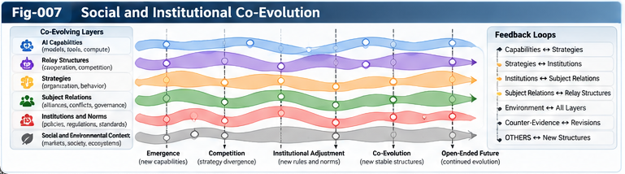

# SSICR-007 — Social Structural Simulation and Co-Evolution

**Repository:** Strategic Structural Intelligence and Competitive UIRTU-Relay (SSICR)  
**Version:** 1.0.0 — Research framework / proposed hypotheses  
**Authors:** Sizhe Tan & GPT-Obot  
**Status:** Conceptual architecture and validation agenda; no empirical results claimed  

## Abstract

Competitive UIRTU-Relay systems connect modular intelligence units, strategic subjects, and adaptive interactions. This paper investigates their possible use as a computational substrate for social-structural simulation: the study of how heterogeneous subjects, their relay relationships, and their institutions jointly change over time. Rather than treating society as a fixed population of agents with static behavioral rules, the proposed framework models change at three distinct levels: within-subject capabilities and strategies, between-subject relay networks, and institutional rules that constrain and are reshaped by interaction. We introduce a bidirectional mapping between established computational social-science methods and UIRTU-Relay abstractions, an open-subject model with explicit residual uncertainty, a multi-timescale co-evolution loop, and a validation program focused initially on competing AI research organizations. The intended output is not a single forecast of social outcomes. It is a set of conditional strategic advantage maps, mechanism hypotheses, failure boundaries, and revisable institutional principles. The approach is a research proposal; its explanatory power and transferability require empirical testing.

**Keywords:** strategic structural intelligence; UIRTU-Relay; agent-based modeling; multi-agent systems; institutional evolution; computational social science; strategic advantage maps; open-subject modeling; counter-evidence; human strategic sovereignty.

---

## 1. Research Question and Scope

How can a simulation framework represent and test the joint evolution of autonomous strategic subjects, the relationships connecting them, and the rules governing their interactions?

This question is broader than selecting an optimal strategy for one subject. It asks whether the simulation can capture feedback loops in which (a) agents adapt to competition, (b) their cooperation and rivalry alter network structure, and (c) emerging institutions reshape incentives and future behavior.

The proposal focuses on **general, bounded, auditable simulations** of organizations, markets, research ecosystems, and institutional processes. It does not claim to predict political crises, wars, or real populations from synthetic-agent outputs. High-stakes applications require domain-specific safeguards, expert review, and independent empirical validation.

## 2. What Existing Fields Already Provide

This work builds on, rather than replaces, several established traditions:

- **Agent-based modeling (ABM):** heterogeneous actors, local interaction rules, and emergent macro-patterns.
- **Multi-agent systems and multi-agent reinforcement learning (MAS/MARL):** interacting policies, coordination, competition, and learning.
- **Evolutionary and repeated games:** adaptation, cooperation, strategic response, and equilibrium concepts.
- **System dynamics:** stocks, flows, feedback, and aggregate trajectories.
- **Institutional and organizational economics:** rules, incentives, transaction costs, authority, and collective action.
- **Computational social science:** empirical calibration, network data, behavioral evidence, and policy evaluation.

The **hypothesized contribution** of SSICR is an interoperable structural layer connecting subject contracts, modular UIRTU execution, dynamic relay networks, multi-perspective scoring, counter-evidence, and open-ended structural revision. Whether this integration yields a measurable improvement over conventional ABM/MARL baselines remains an open empirical question.

## 3. Three Co-Evolving Structural Levels

### 3.1 Intra-subject evolution

Each strategic subject may revise its internal units, allocation policies, knowledge, and strategies. An RSI implemented through multiple agents can be represented as a UIRTU only when its boundaries, contracts, state, evaluation, and feedback are sufficiently explicit. An execution unit is not automatically an independent strategic subject.

### 3.2 Inter-subject relay evolution

Subjects form, maintain, renegotiate, or terminate cooperative, competitive, adversarial, and mixed-motive relations. Links carry not only work products but also information, permissions, dependencies, commitments, and sometimes learning rights. Network topology is a state variable, not a fixed background.

### 3.3 Institutional evolution

Rules, standards, arbitration mechanisms, access controls, and collective agreements may emerge, stabilize, or break down. Institutions can be represented as constraints and incentive-shaping mechanisms; they need not be treated as agents with their own goals unless the modeled institution has an explicit decision process.

**Key distinction:** these levels interact but should not be collapsed into a single measure of “system size.” The novelty sought is change in strategic relationships and rules, not simply an increase in agent count.

---



---

## 4. A Minimal Formal Model

Let a simulation state at time *t* be

$$
X_t = (S_t, R_t, I_t, E_t, K_t),
$$

where:

- \(S_t\): subject states, including capabilities, objectives, internal UIRTU structures, and policies;
- \(R_t\): typed relay relationships and network topology;
- \(I_t\): institutional rules and enforcement mechanisms;
- \(E_t\): environmental conditions and resources;
- \(K_t\): available evidence, uncertainty, and provenance.

For subject \(i\), let its action be chosen under its own authorized objectives and information:

$$
a_{i,t} \sim \pi_i(\cdot \mid o_{i,t}, W_{i,t}, C_{i,t}),$$

where \(o_{i,t}\) is observation, \(W_{i,t}\) is a revisable world model, and \(C_{i,t}\) contains contracts and constraints. The transition is

$$
X_{t+1} \sim P_{\theta_t}(\cdot \mid X_t, a_{1,t},\ldots,a_{n,t}),
$$

with \(\theta_t\) denoting assumptions about behavior and mechanisms. Changes to \(\theta_t\) must be versioned and distinguished from changes in the simulated world; otherwise model revision can be mistaken for real institutional evolution.

A useful decomposition is:

$$
\Delta X_t = (\Delta S_t,\Delta R_t,\Delta I_t,\Delta E_t,\Delta K_t).
$$

This decomposition is descriptive, not an assertion that the terms are independent.

## 5. Open-Subject Modeling and OTHERS

Social and organizational actors are only partially specified. Their motivations, capabilities, information, and decision procedures can change during interaction. A practical subject representation should therefore separate:

1. **Measured attributes:** resources, budgets, deadlines, observed outputs.
2. **Hypothesized mechanisms:** risk preferences, cooperation propensities, adaptation rules.
3. **Structural capabilities:** internal agents, tools, relay contracts, organizational links.
4. **Unmodeled residuals (OTHERS):** unexplained observations, unknown influences, and competing explanations.

OTHERS is an evidence-management category, **not** a free parameter that excuses failed predictions. A candidate mechanism graduates from OTHERS only after it has a defined test, provenance, and demonstrated improvement on held-out evidence.

## 6. Bidirectional Social–Structural Mapping

| Social-science construct | Candidate SSICR representation | Modeling caution |
|---|---|---|
| Individual, firm, research lab | Strategic subject | Do not assume all actors have stable goals |
| Organizational subunit | UIRTU / RSI unit | A unit need not possess independent sovereignty |
| Exchange or collaboration | Cooperative relay contract | Information and learning permissions differ |
| Rivalry and strategic response | Competitive/adversarial relay | Conflict need not imply zero-sum payoff |
| Social network | Dynamic typed relay graph | Missing links and informal ties matter |
| Regulation or standard | Institutional constraint | Enforcement and compliance must be modeled |
| Norm or shared convention | Institutional state / learned policy | Emergence does not establish legitimacy |
| Innovation | Structural growth event | Novelty must be assessed separately from performance |
| Behavioral anomaly | Counter-evidence / OTHERS | Avoid post hoc rationalization |

The mapping runs in both directions: social science contributes mechanisms and empirical constraints; UIRTU-Relay offers a modular computational representation for controlled tests. Neither direction guarantees faithful social prediction.

## 7. Relay Relations as Dynamic State

Each relay edge should have a type and a contract, for example:

`relation = {source, target, type, purpose, permitted_data, allowed_actions, learning_rights, duration, exit_rule, provenance}`

A relation can shift over time: a pair of organizations may compete in products, collaborate on standards, and disagree on data access simultaneously. Therefore, the model should support **multi-relational edges**, rather than assigning a single permanent “friend or foe” label.

A change in relay topology is analytically distinct from a change in individual policy. Simulations should report both.

## 8. Institutional Formation and Failure

Repeated interactions can motivate subjects to propose contracts, standards, arbitration, resource-sharing rules, or collective restrictions. But institutional change is not automatically beneficial. A simulation must allow:

- cooperation and mutual gains;
- coordination failure and costly deadlock;
- exclusion, lock-in, and concentration of control;
- rule evasion and uneven enforcement;
- institutional collapse or replacement.

An institution should be evaluated across multiple perspectives: participating subjects, excluded subjects, overall system performance, and relevant rights or safety constraints. A stable institution may still be unjust, inefficient, or fragile.

## 9. Strategic Worldviews and Institutional Feedback

A **Strategic Advantage Map (SAM)** records where a strategy appears comparatively effective, under which assumptions, against which opponents, and with what evidence. A **Strategic Worldview Forest (SWF)** organizes revisable interpretations and principles derived from such maps.

The co-evolution loop is:

1. Subject worldviews shape which strategies are proposed.
2. Strategies instantiate UIRTU-Relay structures and interactions.
3. Interactions generate outcomes and potentially alter institutions.
4. Institutional changes alter future feasible actions and incentives.
5. Observations and counter-evidence update maps and world models.
6. Authorized actors decide whether normative objectives or action boundaries should change.

**Epistemic revisions** (what the model believes works) must remain distinct from **normative revisions** (what a subject is permitted or committed to pursue).

## 10. Multi-Strategy Simulation Architecture

A proposed simulation pipeline:

```text
Scenario & evidence registry
          |
Strategic subject / relay contract initialization
          |
Strategy and counter-strategy generation
          |
Multi-agent UIRTU-Relay execution
          |
Dynamic network and institution updates
          |
Multi-perspective scoring and uncertainty estimation
          |
Counter-evidence / adversarial model criticism
          |
Strategic Advantage Map updates
          |
Principle and Worldview Forest candidates
          |
Human review, authorization, and next experiment
```

The pipeline is iterative, not a one-pass optimizer. Each run must record simulation code/model version, configuration, random seed, input evidence, policy versions, and the full event trace necessary for replay.

## 11. Adaptive Compute and Search

Large-scale compute should be allocated adaptively rather than uniformly. A defensible search program can use:

- inexpensive screening across broad strategy families;
- cross-play among diverse opponents;
- repeated seeds and sensitivity analysis;
- high-fidelity simulation for promising or uncertain regions;
- out-of-distribution and adversarial stress tests;
- periodic re-evaluation after structural or institutional changes.

Compute allocation should prioritize **information gain and decision relevance**, not only high observed scores. Otherwise the search may converge on strategies that exploit one simulator's weaknesses.

## 12. Comparative Advantage, Not Universal Winners

Let \(\pi\) be a strategy, \(c\) a context, \(q\) an opponent-policy distribution, and \(h\) a time horizon. An empirical advantage estimate can be defined relative to a baseline \(\pi_0\):

$$
\widehat{A}(\pi;c,q,h)
= \widehat{U}(\pi;c,q,h)
- \widehat{U}(\pi_0;c,q,h).
$$

The map should retain confidence intervals or uncertainty bounds, scenario support, alternative metrics, and failure cases. It should not claim an advantage outside the sampled or validated region. “Comparative advantage” here denotes conditional strategic performance, not necessarily the precise opportunity-cost concept in international trade theory.

## 13. Example: Competing AI Research Organizations

Consider three synthetic research organizations:

- **A — Centralized:** shared compute pool and centralized task allocation.
- **B — Distributed:** multiple specialized RSI/UIRTU research units with local autonomy.
- **C — Hybrid/Open:** internal core capability with selected external relay contracts.

All receive controlled task distributions, comparable compute budgets, and specified research goals. They may compete for scarce compute, share non-sensitive benchmark results, or join an optional common evaluation standard. No real-world organization is modeled or targeted.

Experimental factors include resource scarcity, task volatility, information-sharing permissions, trust, opponent adaptation, and policy shocks. Outcomes include research throughput, quality, resource efficiency, robustness, relay overhead, innovation diversity, and institutional stability.

**Institutional intervention:** allow the agents to propose a shared benchmark standard or data-sharing rule. Compare whether it emerges, who benefits, who is excluded, and whether the resulting rules remain robust after environmental change.

## 14. Baselines and Ablations

At minimum, compare:

1. Fixed-rule ABM with static organizational structures.
2. Adaptive agents with fixed relay topology.
3. Adaptive agents with dynamic relay topology.
4. Dynamic relay plus institution updates.
5. Full SSICR prototype with SAM/SWF feedback and counter-evidence.

Ablate dynamic institutions, OTHERS handling, multi-perspective scoring, and cross-model validation independently. Hold compute budgets and evaluation scenarios comparable to avoid crediting added compute to architectural innovation.

## 15. Testable Hypotheses

**H1 — Structural expressivity.** Dynamic relay contracts represent meaningful organizational changes that fixed-edge baselines cannot represent without ad hoc extensions.

**H2 — Conditional performance.** Advantage maps conditioned on context and opponent behavior improve held-out strategy selection compared with a global winner ranking.

**H3 — Co-evolution effects.** Allowing both relay topology and institutional rules to change produces measurably different trajectories from policy-only adaptation under matched initial conditions.

**H4 — Counter-evidence benefit.** Independent critics and held-out scenarios reduce simulator-specific overfitting compared with score-only strategy selection.

**H5 — Open-subject benefit.** Explicitly tracked unknown mechanisms and subsequent validated revisions improve out-of-sample explanatory or predictive performance compared with unversioned post hoc tuning.

**H6 — Governance separation.** Separating epistemic updates from normative authorizations reduces unauthorized objective or permission changes without eliminating useful model adaptation.

Each hypothesis needs predeclared metrics, uncertainty estimates, negative controls, and a meaningful possibility of rejection.

## 16. Validation and Scientific Limits

### 16.1 Internal validity

Test reproducibility across seeds, sensitivity to behavioral assumptions, conservation of resources, contract enforcement, and correctness of institution transitions.

### 16.2 External validity

Where appropriate, compare simulated mechanisms with historical or observed organizational data. Synthetic-agent plausibility is insufficient evidence of real-world predictive validity.

### 16.3 Cross-model robustness

Re-run key findings under independently specified agent policies, alternate environment models, and different scoring perspectives. Record disagreements rather than averaging them away.

### 16.4 Human and institutional validity

Assess whether generated rules preserve stated permissions, transparency, and the right to exit. Human reviewers should be able to reject strategically effective but unauthorized or unacceptable outcomes.

### 16.5 Model risk

Major risks include Goodhart effects, self-confirming worldviews, strategic manipulation of evaluators, missing social variables, nonstationarity, distribution shift, false precision, and confounding between simulated and model-development changes.

## 17. Human Strategic Sovereignty

AI may generate and test more strategies than people can inspect individually. The appropriate response is **structured compression with inspectable evidence**, not silent delegation of final authority. The system should expose:

- alternative strategies and their conditional advantage regions;
- assumptions, uncertainty, and failure boundaries;
- affected stakeholders and competing scoring perspectives;
- traceable reasons for proposed institutional changes;
- explicit approval gates for changes to objectives, permissions, and high-impact actions.

The simulation is a decision-support instrument. It must not automatically redefine a subject's goals or treat simulation outcomes as authorization to act in the world.

## 18. Proposed Research Program

**Phase I — Minimal substrate.** Implement a small synthetic organizational environment with typed subjects, contracts, and replayable event logs.

**Phase II — Dynamic relations.** Add mixed-motive edges, partner switching, and opponent adaptation. Establish fixed-structure baselines.

**Phase III — Institutional mechanisms.** Add rule proposals, negotiation, enforcement, exit, and institutional shocks.

**Phase IV — Advantage mapping.** Construct conditional SAM records with counter-evidence, provenance, and uncertainty.

**Phase V — Worldview and governance.** Test whether revisable principle families improve held-out decision support while preserving normative authorization boundaries.

**Phase VI — External comparison.** Seek domain-expert evaluation and cautiously compare mechanisms with real organizational evidence.

## 19. Open Questions

1. What is the smallest subject contract sufficient for meaningful strategic simulation?
2. Which institutional mechanisms are robust across different agent architectures?
3. How can informal social relationships be represented without false precision?
4. When does adding structural complexity improve generalization rather than overfit?
5. Can a SAM remain useful under rapid changes in the opponent population?
6. What evidence justifies promoting an OTHERS hypothesis into a named mechanism?
7. How should the system represent fundamentally incomparable stakeholder values?
8. How can a human auditor understand a strategy selected from millions of simulated candidates?
9. Which aspects of a worldview can be learned automatically, and which require explicit authorization?
10. Under what conditions do stable institutions reduce rather than amplify systemic risk?

## 20. Relationship to the SSICR Series

- **SSICR-001:** generalized cooperative, competitive, adversarial, and mixed-motive relay relations.
- **SSICR-002:** subject identity, sovereignty, and cross-boundary relay contracts.
- **SSICR-003:** strategic control planes and multi-perspective scoring.
- **SSICR-004:** massive multi-strategy simulation and adaptive compute allocation.
- **SSICR-005:** contextual comparative advantage maps and failure boundaries.
- **SSICR-006:** strategic worldview forests and revisable principle systems.
- **SSICR-007 (this paper):** the social, organizational, and institutional co-evolution layer.
- **SSICR-008 (planned):** human strategic sovereignty and governance.
- **SSICR-009 (planned):** open-ended strategic RSI.
- **SSICR-010 (planned):** unified architecture and research horizon.

The work also draws conceptually on the broader SI research line: UIERU/UIRTU, SIF, UCPSF, Subjective Structural Intelligence, Structural RSI, BM-ODWEI, and PI-OSL. These are proposed architectural connections, not empirical demonstrations.

## 21. Conclusion

Social structural simulation offers a possible bridge between modular intelligence engineering and computational social science. Its distinctive challenge is not to simulate more agents, but to represent **three mutually shaping forms of change**: subjects changing internally, relationships changing between subjects, and institutions changing the space of permissible and attractive actions.

Large-scale UIRTU-Relay simulation could help discover context-dependent strategic advantages and the conditions under which cooperative or competitive institutions arise. Its value depends on transparent assumptions, strong baselines, independent counter-evidence, careful external validation, and human control of normative decisions. The research goal is a **revisable landscape of mechanisms, strategic options, and failure boundaries**—not a universal social predictor or an automated sovereign.

---

## Citation Guidance

When publishing this paper, add verified bibliographic references for ABM, MARL, evolutionary game theory, system dynamics, institutional economics, and computational social science. No empirical findings or externally verified citations are asserted in this draft.

## License and Versioning

This document is part of the proposed SSICR v1.0.0 research repository. Repository-wide licensing and archival metadata are governed by the top-level `LICENSE.txt`, `CITATION.cff`, and `.zenodo.json` files.
