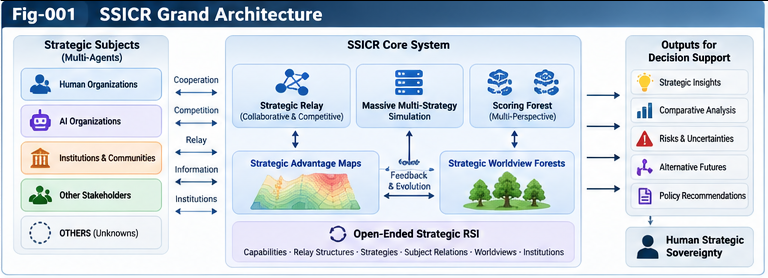

# SSICR-010 — Unified Architecture and Research Horizon

**Strategic Structural Intelligence and Competitive UIRTU-Relay**  
**From Multi-Strategy Simulation to Comparative Advantage Maps, Strategic Worldviews, and Human Strategic Sovereignty**

**Authors:** Sizhe Tan & GPT-Obot  
**Version:** 1.0.0  
**Status:** Research framework and testable proposals; not an empirically validated universal theory  
**Repository:** `Strategic-Structural-Intelligence-and-Competitive-UIRTU-Relay`  
**Document:** `docs/SSICR-010-Unified-Architecture-and-Research-Horizon.md`

---

## Abstract

This concluding paper synthesizes the Strategic Structural Intelligence and Competitive UIRTU-Relay (SSICR) research program. It generalizes voluntary cooperative intelligence relay to competitive, adversarial, mixed-motive, and institutionally mediated relationships among strategically autonomous subjects. The proposed architecture connects open strategic-subject models, bounded UIRTU/RSI units, strategic control planes, large-scale multi-strategy simulation, perspective-dependent scoring, strategic comparative advantage maps, strategic worldview forests, open-ended structural self-improvement, and human strategic sovereignty. Rather than claiming a globally optimal strategy or an accurate digital replica of society, SSICR proposes an evidence-traceable computational method for identifying **where strategies work, where they fail, for whom, under which assumptions, and over what horizon**. A competitive AI-research-and-development sandbox is proposed as an initial falsifiable testbed. The paper specifies architecture interfaces, evaluation logic, failure modes, governance requirements, testable hypotheses, staged validation, and an open research horizon.

**Keywords:** structural intelligence; UIRTU-Relay; multi-agent systems; strategic simulation; comparative advantage maps; scoring forest; worldview evolution; recursive self-improvement; institutional co-evolution; human strategic sovereignty.

## 1. The Research Transition

Earlier structural-intelligence work emphasized capability representation, composable intelligence units, localization, relay, evaluation, and structural growth. Those mechanisms remain necessary, but not sufficient, when independently governed subjects interact with conflicting goals.

A cooperative relay asks: *Which units can jointly complete a task?* A strategic relay also asks: *Who benefits, whose objectives govern, how will others respond, and how might the interaction change the participants and the rules of interaction?*

This is not merely a larger granularity of the same computation. It introduces autonomous objective systems, asymmetric information, reciprocal adaptation, bargaining, contestation, and institutions as endogenous variables. SSICR therefore treats cooperation as one possible relationship state within a broader strategic relay space.

### 1.1 Central thesis

> The principal output of large-scale strategic simulation should not be a single winning strategy. It should be a revisable, evidence-grounded map of context-dependent strategic advantages and failure boundaries, supporting plural strategic worldviews and human-governed choice.

### 1.2 What is proposed—and what is not

SSICR proposes a **research architecture** and a set of **testable hypotheses**. It does not establish that increasing simulation compute alone yields reliable real-world predictions; that social subjects can be fully specified; that one ideology is optimal; or that AI should inherit authority over human objectives. The novelty claim concerns the *integration and interfaces* of several existing and proposed ideas, not the invention of multi-agent simulation, game theory, wargaming, or agent-based modeling.

## 2. Conceptual Foundations and Scope

### 2.1 UIRTU and RSI as bounded units

An RSI workflow may be represented as a UIRTU-like relay unit **when** it has an explicit identity, input/output contract, state boundary, evaluator, permitted actions, and traceable feedback. A collection of agents is not automatically an independent strategic subject. Subjecthood in this framework is an operational modeling construct defined by accountable objective ownership and decision authority; it does not imply consciousness or moral personhood.

### 2.2 Five relationship classes

| Class | Relationship | Typical modeling question |
|---|---|---|
| Cooperative | Compatible or complementary objectives | How can joint value be created? |
| Competitive | Rival claims on scarce resources or outcomes | Where does differentiation outperform imitation? |
| Adversarial | Directly conflicting objectives or hostile actions | Which strategies remain robust under opposition? |
| Mixed-motive | Cooperation and conflict coexist | When are negotiation, coalition, or exit preferable? |
| Co-evolutionary | Repeated interaction changes strategies and structures | Which new relationships or institutions emerge? |

These classes can overlap and change over time; they are not immutable subject types.

### 2.3 Relation to established disciplines

SSICR should be compared with agent-based modeling, multi-agent reinforcement learning, evolutionary game theory, mechanism design, operations research, system dynamics, robust optimization, and computational social science. Its proposed contribution is a modular bridge between **structural relay evolution**, **contextual advantage knowledge**, **worldview-level interpretation**, and **governance**. Comparative empirical work is needed to establish whether this bridge improves performance over simpler alternatives.

## 3. Unified Functional Architecture

The architecture consists of seven interacting functions, not a rigid hierarchy of command:

1. **Open Strategic Subjects:** identity, objectives, resources, behavioral assumptions, uncertainty, and authority boundaries.
2. **Competitive UIRTU-Relay:** composable units and relationship-aware contracts spanning cooperation, rivalry, and contestation.
3. **Multi-Strategy Simulation:** generation, execution, cross-play, perturbation, and repeated interaction across scenario families.
4. **Scoring and Counter-Evidence:** perspective-aware evaluation, uncertainty estimates, falsification, and anti-Goodhart safeguards.
5. **Strategic Advantage Maps (SAM):** conditional performance surfaces, failure regions, transferability limits, and provenance.
6. **Strategic Worldview Forests (SWF):** plural, revisable principles and interpretive models distilled from maps and external evidence.
7. **Human Strategic Sovereignty (HSS):** human authorization of goals, value boundaries, consequential actions, audit, and revocation.

```text
          Human Strategic Sovereignty
         objectives | authorization | audit
                         |
              Strategic Worldview Forest
                 principles | perspectives
                         ^  |
                         |  v
             Strategic Advantage Maps
          regions | boundaries | uncertainty
                         ^  |
                         |  v
              Scoring & Counter-Evidence
             critics | validation | provenance
                         ^  |
                         |  v
             Massive Multi-Strategy Simulation
          generation | cross-play | perturbations
                         ^  |
                         |  v
              Competitive UIRTU-Relay
            contracts | interactions | adaptation
                         ^  |
                         |  v
                 Open Strategic Subjects
              identities | resources | OTHERS
```

---



---

### 3.1 The interfaces matter more than a monolithic implementation

Each layer should publish versioned inputs, outputs, assumptions, provenance, and permitted transitions. Simulators may be swapped without rewriting subjects; scorers may be compared without silently changing objectives; worldview revisions must preserve their evidential lineage; governance checks must remain enforceable outside the optimizer.

## 4. Strategic Subject and Boundary Model

A minimal subject model is

\[
S_i = (I_i, O_i, R_i, B_i, W_i, \Pi_i, A_i, E_i),
\]

where identity \(I_i\), objectives \(O_i\), resources \(R_i\), boundaries \(B_i\), worldview \(W_i\), strategy set \(\Pi_i\), authorized actions \(A_i\), and evidence state \(E_i\) are explicit but incomplete. This tuple is a **proposed schema**, not a validated behavioral law.

Six boundaries should be represented independently: **identity**, **objective**, **information**, **action**, **learning**, and **governance**. A cross-subject relay can share services and evidence without transferring ownership of goals. No unit may expand its authority merely because simulation identifies a higher score.

### 4.1 Open-subject modeling

A subject's behavior may be under-specified or change endogenously. SSICR therefore separates observed variables, estimated latent variables, structural assumptions, and **OTHERS**—a documented space for residuals, surprises, and unresolved explanations. OTHERS must not be used as an unfalsifiable explanation for every mismatch.

## 5. Strategic Control Planes and Perspective-Aware Scoring

A strategic control plane coordinates scenario interpretation, candidate construction, relay selection, opponent modeling, evaluation, and permitted action. It is subordinate to the subject's authorized objectives.

For strategy \(\pi\), context \(c\), opponent configuration \(o\), perspective \(p\), and horizon \(h\), define an illustrative evaluation function:

\[
Q(\pi \mid c,o,p,h) = \mathbb{E}[U_p(\pi,c,o,h)] - \lambda_p\,\mathrm{Risk}(\pi,c,o,h) - \mu_p\,\mathrm{Cost}(\pi,c,o,h).
\]

Weights and utility definitions are perspective-dependent, externally governed, and subject to sensitivity analysis. A single scalar score can obscure non-compensable constraints; therefore, report the underlying multi-objective vector, Pareto trade-offs, and feasibility status alongside any aggregation.

### 5.1 Dynamic opposition

Opponents are not stationary background parameters. Evaluation should consider fixed baselines, learned opponents, previously unseen policies, and strategically adaptive opponents. When opponents adapt, results depend on the learning protocol, information structure, and interaction horizon.

## 6. Massive Multi-Strategy Simulation as the Search Engine

The proposed computational pipeline is:

**Generate → Screen → Cross-Play → Stress-Test → Validate → Map → Extract Principles → Re-enter Search.**

The design space includes strategies, relay topologies, resource allocations, opponents, environments, time horizons, and institutional rules. Search should be hierarchical and compute-aware rather than an indiscriminate Cartesian enumeration.

### 6.1 Compute allocation

A practical budget hierarchy includes inexpensive surrogate screening, intermediate simulations, adversarial stress tests, and high-fidelity validation on held-out conditions. Allocate additional compute when the expected information gain or decision relevance justifies it. Report simulation budget and opportunity cost, not only the best observed score.

### 6.2 Experimental reproducibility

Each run should record scenario ID, simulator version, subject/strategy versions, seed, initial conditions, opponent policy, evaluation specification, resource budget, event trace, and outcome metrics. Where stochasticity or LLM nondeterminism prevents exact replay, report replication distributions and artifacts sufficient for independent assessment.

### 6.3 Simulation realism is a limiting resource

More compute cannot repair an invalid model. Calibration to observations, out-of-sample tests, cross-simulator comparisons, and explicit domain-shift warnings are required before drawing real-world conclusions. AI-R&D sandboxes are proposed first because selected task and resource variables can be measured more directly than many political or social variables.

## 7. Strategic Comparative Advantage Maps

A Strategic Advantage Map is a structured representation of **relative** strategy performance under specified contexts, opponents, objectives, and horizons. Here *comparative advantage* is used in the broad conditional strategic sense, not automatically the strict economic sense of opportunity-cost advantage.

For strategies \(\pi_a\) and \(\pi_b\), define a conditional difference:

\[
\Delta_{a,b}(c,o,p,h) = Q(\pi_a\mid c,o,p,h) - Q(\pi_b\mid c,o,p,h).
\]

An advantage region is a set of contexts in which this difference is credibly positive **under stated assumptions and uncertainty criteria**. A failure boundary is where performance degrades, feasibility fails, or evidence becomes insufficient. These boundaries should be reported as uncertain rather than falsely precise.

### 7.1 Map records

A minimum record contains: strategy family and version; subject and objective perspective; context and opponent class; horizon; comparator; performance vector; uncertainty interval; robustness and failure cases; counter-evidence; simulator and data provenance; and last validation date.

### 7.2 Map governance

Maps should retain losing and inconclusive strategies when informative. Evidence cannot be overwritten by a new winner. A map should state where it has **not** been tested and distinguish simulated superiority from demonstrated real-world transfer.

---


---

## 8. From Maps to Strategic Worldview Forests

A map answers *where a strategy seems to work*. A worldview adds hypotheses about *why the environment behaves as it does*, which evidence matters, and which strategic principles should guide further inquiry. The proposed progression is:

\[
\text{Scenario Evidence} \rightarrow \text{Advantage Maps} \rightarrow \text{Conditional Principles} \rightarrow \text{Worldview Forest}.
\]

The reverse direction is equally important: worldviews shape candidate generation and interpretation, and must be challenged by counter-evidence.

### 8.1 Worldview plurality

Cooperative, competitive, defensive, adaptive, and institutional orientations may coexist as **hypothesis families**. None is universally superior. Forests preserve provenance, conflicts, exceptions, and alternative causal interpretations rather than collapsing into a single dogma.

### 8.2 Epistemic revision versus normative change

Evidence can justify revision of descriptive beliefs, causal models, and conditional strategic principles. It does not automatically authorize a change in human values, institutional mandates, or action permissions. This separation is a non-negotiable governance invariant.

---


---

## 9. Open-Ended Strategic RSI and Co-Evolution

SSICR extends structural self-improvement along five coupled axes: unit capabilities, relay architecture, strategy families, inter-subject relationships, and strategic worldviews. A successful change in one subject may alter the response landscape for every other subject.

A conceptual update equation is:

\[
X_i^{t+1}=F_i(X_i^t, X_{-i}^t, C_t, E_i^t),
\]

where \(X_i\) represents subject \(i\)'s strategy and relevant structural state, \(X_{-i}\) other subjects, \(C_t\) institutional/environmental context, and \(E_i^t\) available evidence. This is a modeling template, not a claim of deterministic social dynamics.

The growth loop is **candidate change → sandbox trial → comparative evaluation → adversarial counter-evidence → authorized adoption → provenance-preserving update**. Failed proposals remain useful evidence. The system should avoid uncontrolled self-modification or automatic changes to permissions.

## 10. Social Systems and Institutional Co-Evolution

Social science supplies behavior theories, historical cases, incentive structures, and institutional constraints; SSICR supplies a candidate modular representation for controlled computational experiments. The mapping is bidirectional but not one-to-one: a state, firm, citizen, and software agent differ fundamentally in agency, legitimacy, and accountability.

Three levels can co-evolve:

1. **Within-subject:** capabilities, organization, preferences, and strategy.
2. **Between-subject:** competition, coalition, exchange, and relay contracts.
3. **Institutional:** norms, standards, governance, and enforcement mechanisms.

Institutions may improve coordination, entrench power, or collapse. The model must permit negative outcomes and avoid assuming that repeated interaction necessarily produces cooperation.

### 10.1 Military and non-military precedents

Wargaming and operations research offer mature traditions of scenario construction, uncertainty management, red-teaming, and after-action review, but cannot fully predict human political behavior. Finance, economics, business, and social science also possess substantial simulation traditions. SSICR should study their interfaces and limits without claiming that these domains lack computational methods.

## 11. Human Strategic Sovereignty

A principal motivation is the possibility that AI-generated strategy streams will exceed human capacity for direct inspection. The answer is not unrestricted AI strategic authority. It is to convert exploration into interpretable, contestable, auditable strategic knowledge.

> AI should not merely make more strategic decisions for humans. It should help humans perceive a wider space of possible futures, understand the costs and boundaries of their choices, and strengthen their capacity to choose their own future.

### 11.1 Sovereignty invariants

- **Objective ownership:** the accountable human or institution controls strategic goals.
- **Explicit authorization:** consequential actions require authority matched to their risk.
- **Bounded delegation:** scopes, budgets, tools, and expiry are machine-enforceable.
- **Evidence visibility:** uncertainty, rejected options, and counter-evidence remain inspectable.
- **Revocability:** delegated authority can be suspended and audited.
- **No silent value rewrite:** optimizer performance does not authorize normative changes.

### 11.2 Human-comprehensible strategic compression

An executive decision package should present a small set of materially different options, their advantage regions, assumptions, failure boundaries, disagreement among evaluators, reversibility, and action permissions. Compression should not conceal adverse evidence or pretend to remove irreducible uncertainty.

## 12. A Minimal Interoperability Contract

The following YAML is **illustrative**, not a finalized standard. The corresponding normative details belong in `SPEC-001` through `SPEC-004`.

```yaml
ssicr_version: "1.0-draft"
subject:
  id: "research-org-a"
  objective_owner: "authorized-human-governance"
  objectives: ["research_quality", "resource_efficiency"]
  constraints: ["budget_limit", "data_access_policy"]
relay:
  contract_id: "relay-contract-17"
  unit_ids: ["literature-unit", "experiment-unit", "evaluator-unit"]
  permitted_actions: ["sandbox_only"]
strategy:
  id: "hybrid-research-v3"
  family: "hybrid-relay"
simulation:
  scenario_id: "rd-competition-scenario-04"
  simulator_version: "sandbox-0.2"
  seeds: [101, 102, 103]
  opponent_policy_class: "adaptive"
evaluation:
  perspectives: ["quality", "cost", "robustness"]
  uncertainty_method: "replicated-runs"
  counter_evidence_required: true
advantage_map:
  region_id: "region-pending-validation"
  comparator_strategy_id: "centralized-research-v1"
  evidence_status: "simulation-only"
worldview:
  principle_candidates: []
  normative_changes_authorized: false
governance:
  human_approval_required_for_external_actions: true
  audit_trace_required: true
```

## 13. Initial Validation Sandbox: Competitive AI R&D

### 13.1 Why start here?

An AI-research sandbox permits partial measurement of compute budgets, task completion, quality, latency, and relay costs while retaining nontrivial competitive and cooperative behavior. It does **not** fully reproduce real R&D organizations or innovation economics.

### 13.2 Baselines and treatment arms

Compare at least:

- **B0:** single fixed research strategy, no adaptation.
- **B1:** manually selected small strategy portfolio.
- **B2:** automated strategy search with fixed relay architecture.
- **B3:** automated strategy search with adaptive relay architecture.
- **B4:** B3 plus cross-play, counter-evidence, and held-out validation.
- **B5:** B4 plus worldview-guided search and human governance interface.

Hold compute budgets and available task information comparable where possible. Evaluate against multiple opponent populations and withheld scenario distributions, including adverse or unexpected conditions.

### 13.3 Outcome metrics

Measure task quality, cost-adjusted performance, resilience to opponent shifts, transfer to new scenarios, diversity of non-dominated strategies, calibration of uncertainty, evaluator exploitability, human decision quality, and governance violations. Track negative results and costs of additional complexity.

## 14. Falsifiable Research Hypotheses

**H1 — Conditional-map utility.** A validated advantage map improves decisions across heterogeneous contexts relative to a single global strategy ranking, under matched information and compute budgets.

**H2 — Adaptive-relay benefit.** Allowing relay structures to change improves at least some held-out competitive tasks relative to fixed architectures, net of search and coordination costs.

**H3 — Counter-evidence robustness.** Cross-play, red-team critics, and cross-simulator validation reduce performance collapse under opponent and environment shift compared with training-only evaluation.

**H4 — Worldview value.** A provenance-preserving worldview forest improves transfer, interpretability, or sample efficiency over an equally resourced map-only baseline; it may fail on some tasks.

**H5 — Open-subject modeling.** Explicit residual/OTHERS handling and selective structural updates improve uncertainty calibration or out-of-distribution performance over rigid fixed-subject models.

**H6 — Human sovereignty.** Decision packages with alternatives, assumptions, and failure boundaries improve calibrated human strategic choices while reducing unauthorized-action rates relative to opaque AI recommendations.

**H7 — Institutional emergence.** Under specified repeated-interaction conditions, endogenous relay contracts or governance rules emerge and alter system welfare or stability; the direction of change is empirical, not predetermined.

Each hypothesis requires prespecified metrics, baselines, uncertainty intervals, stopping rules, and criteria for rejection. A positive simulation result alone is not proof of real-world generalization.

## 15. Anti-Goodhart, Safety, and Epistemic Failure Modes

| Failure mode | Consequence | Required mitigation |
|---|---|---|
| Simulator exploitation | High simulated score, poor real performance | Held-out simulators, adversarial tests, external calibration |
| Objective drift | Optimizer changes what success means | Separate immutable authority layer from mutable beliefs |
| Model monoculture | Shared errors across agents and critics | Diverse model families and independent evidence |
| False precision | Spurious confidence in advantage boundaries | Intervals, abstention, sensitivity and uncertainty reporting |
| Feedback contamination | Test data enters strategy generation | Strict split governance and provenance |
| Escalatory dynamics | Competition rewards destructive behavior | Action constraints and welfare-sensitive evaluations |
| Unaccountable delegation | Unauthorized external decisions | Enforced contracts, approval gates, revocation |
| Social misrepresentation | Simplified agents mistaken for real populations | Domain limits, participatory review, external validation |

A successful SSICR implementation must make **non-knowledge** visible. The right output can be “insufficient evidence,” “no robust advantage,” or “requires human judgment.”

## 16. Research Horizon: Near, Medium, and Long Term

### Horizon I — Executable, bounded strategic science

Develop versioned contracts, reproducible simulation environments, baseline comparisons, conditional map records, and adversarial evaluation. Prefer narrow AI-R&D or supply-chain-like settings where inputs and outcomes can be checked.

### Horizon II — Open structural co-evolution

Allow agents, relay topologies, strategies, and selected institutional rules to evolve under controlled conditions. Study adaptation speed, compute allocation, map stability, and principle transfer. Add external data and independent validation partners.

### Horizon III — Plural worldview and social-system inquiry

Investigate how strategic principles and worldview families form and change across domains, including institutional evolution. Preserve value pluralism, contested interpretations, and limits of simulation. Expand to consequential domains only with domain expertise, legitimate governance, and stringent external validation.

### Horizon IV — Strategic intelligence infrastructure

Explore interoperable repositories of strategy families, context-specific advantage maps, counter-evidence, contracts, and worldview revisions. Such infrastructure should enable comparison and human understanding—not centralized control over strategic decisions.

## 17. Relationship to the Broader Structural Intelligence Program

| Research line | Imported idea | New SSICR use |
|---|---|---|
| UIERU / UIRTU | Composable intelligence units and relay | Multi-subject strategic relationships |
| UCPSF | Universal control planes and scoring forests | Perspective-aware strategic selection |
| Subjective Structural Intelligence (SSI) | Subject boundary, agency, worldview | Strategic sovereignty and worldview plurality |
| SIF | Contracts, dual maps, precedents, sandboxes | Interoperable strategic simulation infrastructure |
| Structural RSI | Evaluator governance and recursive growth | Coupled competitive improvement |
| BM-ODWEI | OTHERS and open evidence | Unmodeled subject behavior and surprises |
| PI-OSL | Evidence-to-principle growth | Map-to-principle-to-worldview learning |

The new research object is the **interaction among independently governed strategic subjects**, together with its simulation, evidence structure, institutional consequences, and human oversight. This distinguishes SSICR from merely repackaging its predecessor frameworks.

## 18. Integration with the SSICR Document Series

1. **SSICR-001 — From Cooperative to Strategic Relay:** relation generalization and foundational claims.
2. **SSICR-002 — Strategic Subjects and Relay Boundaries:** subjects, sovereignty, and contracts.
3. **SSICR-003 — Strategic Control Planes and Scoring:** perspective-aware evaluation and strategy selection.
4. **SSICR-004 — Massive Multi-Strategy Simulation:** computational search and experiment engine.
5. **SSICR-005 — Strategic Comparative Advantage Maps:** primary evidence product.
6. **SSICR-006 — Strategic Worldview Forests:** principle extraction and plural interpretive systems.
7. **SSICR-007 — Social Structural Simulation and Co-Evolution:** social and institutional feedback.
8. **SSICR-008 — Human Strategic Sovereignty:** authorization, interpretability, and accountable choice.
9. **SSICR-009 — Open-Ended Strategic RSI:** coupled structural evolution.
10. **SSICR-010 — Unified Architecture and Research Horizon:** this integrative synthesis.

Related technical specifications: `SPEC-001` through `SPEC-004`; proposed cases: `CASE-001` through `CASE-003`; validation materials: `OPEN-QUESTIONS.md`, `TESTABLE-HYPOTHESES.md`, and `VALIDATION-ROADMAP.md`.

## 19. Open Questions

1. What is the smallest strategic-subject representation sufficient for useful transfer across environments?
2. How can simulations detect when opponent or institutional models have become invalid?
3. Which uncertainty estimates remain calibrated under adaptive strategy search?
4. When does a strategic advantage map outperform a portfolio of simpler heuristics?
5. Can conditional principles be extracted without turning empirical regularities into dogma?
6. How should conflicting worldview perspectives be represented without forcing false consensus?
7. How can governance remain enforceable when relay structures and units change rapidly?
8. Which kinds of social-system claims are fundamentally underidentified from available evidence?
9. How should compute be allocated between exploration, replication, and external validation?
10. How can human reviewers retain meaningful control over compressed, high-volume strategy streams?

## 20. Conclusion

The strategic frontier of structural intelligence is not simply a larger network of cooperating units. It is a space of **independent subjects, competing objectives, adaptive relay structures, contested evidence, evolving institutions, and plural worldviews**. Large-scale AI simulation offers a possible means to explore this space, but reliable strategic knowledge requires calibration, comparison, counter-evidence, and explicit uncertainty.

The central artifact is therefore a **Strategic Advantage Map**, not a universal winning strategy. Such maps may support a **Strategic Worldview Forest** of revisable, perspective-aware principles. The ultimate governance principle is that greater AI strategic computation should enlarge human understanding and choice rather than silently replace human strategic authority.

> **AI should expand the strategic futures humans can understand, compare, and choose—not decide those futures in their place.**

---

## Research Integrity and Citation Notes

This document is a proposed theoretical and engineering synthesis. Mathematical expressions are illustrative definitions or modeling templates, not empirical results. No simulations or benchmark outcomes are claimed to have been completed here. Existing fields such as agent-based modeling, game theory, multi-agent reinforcement learning, operations research, and computational social science must be acknowledged in subsequent literature-grounded versions; specific references should be added only after source verification.

**Suggested citation (pending DOI):** Tan, S., & GPT-Obot. (2026). *SSICR-010: Unified Architecture and Research Horizon*. In *Strategic Structural Intelligence and Competitive UIRTU-Relay*, version 1.0.0. GitHub repository. DOI pending.

**License:** See repository-level `LICENSE` for the applicable terms.
